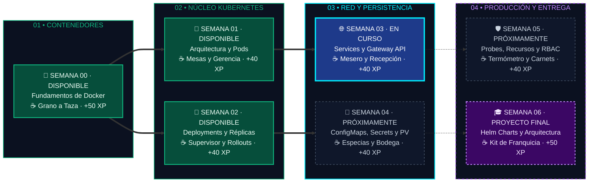
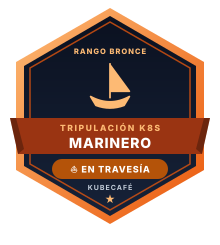
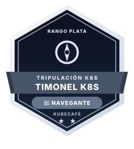
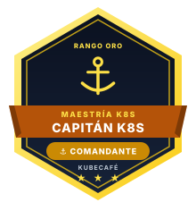
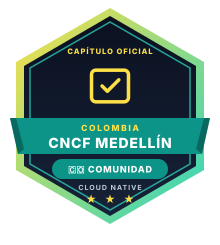

<div align="center">

# ☸️ De Cero a Capitán en Kubernetes
### Workshop Práctico de 6 Semanas — Cloud Native Medellín 🏔️☕

[](https://kubernetes.io/es/)
[](https://ocgroups.dev/cncf/group/2majk4r)
[](https://www.linkedin.com/company/cloud-native-colombia/)
[](https://www.instagram.com/colombiacloudnative/)
[](https://www.youtube.com/@CloudNativeColombia)
[](https://labs.iximiuz.com/trainings/fundamentos-de-docker-y-kubernetes-2ae16ea8/)
[](https://edwinbermudez91.github.io/Fundamentos-Kubernetes/recursos/simulador-interactivo-kubernetes.html)
[](./ASISTENTES.md)
[](./CONTRIBUTING.md)
[](https://opensource.org/licenses/MIT)

<p align="center">
  <b>Un repositorio vivo construido por y para la comunidad.</b><br>
  Aprende haciendo, rompe cosas sin miedo en tu entorno local y haz tu primer aporte al Open Source.
</p>

[🇨🇴 Únete al Capítulo CNCF Medellín](https://ocgroups.dev/cncf/group/2majk4r) •
[🏢 LinkedIn (@cloud-native-colombia)](https://www.linkedin.com/company/cloud-native-colombia/) •
[📸 Instagram (@colombiacloudnative)](https://www.instagram.com/colombiacloudnative/) •
[📺 Grabaciones en YouTube (@CloudNativeColombia)](https://www.youtube.com/@CloudNativeColombia) •
[🧪 Laboratorios Online en iximiuz](https://labs.iximiuz.com/trainings/fundamentos-de-docker-y-kubernetes-2ae16ea8/) •
[☕ Simulador KubeCafé (Cómo Opera K8s)](https://edwinbermudez91.github.io/Fundamentos-Kubernetes/recursos/simulador-interactivo-kubernetes.html) •
[🏆 Muro y Portafolios (`ASISTENTES.md`)](./ASISTENTES.md) •
[📂 Carpeta de Portafolios](./aportes-comunidad/soluciones-retos) •
[🎓 Guía de Portafolio y Badges](./recursos/portafolio-y-badges.md) •
[📔 Formulario de Bitácora Semanal](https://github.com/edwinbermudez91/Fundamentos-Kubernetes/issues/new?template=bitacora-semanal.yml) •
[⚡ Guía Shell DX (Terminal Pro)](./recursos/guia-shell-dx-kubernetes.md) •
[🔄 Sincronizar tu Fork](./recursos/como-sincronizar-tu-fork.md) •
[📊 Diapositivas (PDF)](./recursos/diapositivas/README.md) •
[☕ Analogía KubeCafé](./recursos/de-un-tinto-a-kubernetes.md) •
[⚓ Guía de Harbor](./recursos/guia-harbor-registry.md) •
[🛡️ Guía de Trivy](./recursos/guia-trivy-seguridad.md) •
[🤖 Guía de Ollama](./recursos/guia-ollama-ia-local.md) •
[📂 Explorador Visual](#directorio-visual) •
[🚀 Empezar Ahora](#paso-0-prepara-tu-laboratorio) •
[🗺️ Mapa de Ruta](#mapa-de-ruta) •
[🏆 Rangos y Premios](#-rangos-de-navegación-y-puntaje-gamificación)

</div>

---

> [!IMPORTANT]
> ### 🧭 Recursos Principales del Workshop
> | 🇨🇴 Comunidad Oficial CNCF | 📺 Grabaciones en Vivo | 🧪 Laboratorios en Navegador | ☕ Simulador KubeCafé |
> | :--- | :--- | :--- | :--- |
> | [](https://ocgroups.dev/cncf/group/2majk4r)<br>[**Registro en CNCF Medellín**](https://ocgroups.dev/cncf/group/2majk4r)<br>Únete a la comunidad oficial para próximos eventos y meetups. | [](https://www.youtube.com/@CloudNativeColombia)<br>[**Canal @CloudNativeColombia**](https://www.youtube.com/@CloudNativeColombia)<br>Revive las grabaciones y explicaciones de cada sesión en vivo. | [](https://labs.iximiuz.com/trainings/fundamentos-de-docker-y-kubernetes-2ae16ea8/)<br>[**Playgrounds de Docker y Kubernetes**](https://labs.iximiuz.com/trainings/fundamentos-de-docker-y-kubernetes-2ae16ea8/)<br>Entorno de laboratorios online para practicar sin instalar nada. | [](https://edwinbermudez91.github.io/Fundamentos-Kubernetes/recursos/simulador-interactivo-kubernetes.html)<br>[**Simulador Interactivo K8s**](https://edwinbermudez91.github.io/Fundamentos-Kubernetes/recursos/simulador-interactivo-kubernetes.html)<br>Aprende visualmente cómo opera Kubernetes y la analogía de KubeCafé. |

> [!TIP]
> 📚 **Documentación Oficial de Referencia:**  
> Consulta siempre las fuentes oficiales para validar especificaciones, APIs, parámetros y buenas prácticas:  
> * 🐳 **Docker:** [Documentación Oficial](https://docs.docker.com/) • [Referencia de Dockerfile](https://docs.docker.com/reference/dockerfile/) • [Referencia de CLI Docker](https://docs.docker.com/reference/cli/docker/) • [Almacenamiento y Volúmenes](https://docs.docker.com/engine/storage/volumes/) • [Redes en Docker](https://docs.docker.com/engine/network/)  
> * ☸️ **Kubernetes (Español):** [Documentación Oficial Principal](https://kubernetes.io/es/docs/home/) • [Cheat Sheet Oficial de kubectl](https://kubernetes.io/es/docs/reference/kubectl/cheatsheet/) • [Componentes y Arquitectura](https://kubernetes.io/es/docs/concepts/overview/components/) • [Cargas de Trabajo (Workloads)](https://kubernetes.io/es/docs/concepts/workloads/)  
> * ☁️ **CNCF y Ecosistema:** [Portal Oficial CNCF](https://www.cncf.io/) • [CNCF Interactive Landscape](https://landscape.cncf.io/) • [Documentación Oficial de Kind](https://kind.sigs.k8s.io/) • [Documentación Oficial de Helm](https://helm.sh/docs/)

> [!TIP]
> **¿Es tu primera vez usando GitHub o Kubernetes?** ¡Estás en el lugar correcto! Tu primera misión toma solo 30 segundos: regístrate en el [**Muro de Asistentes (`ASISTENTES.md`)**](./ASISTENTES.md) usando nuestro [**⛵ Formulario Visual de Registro**](https://github.com/edwinbermudez91/Fundamentos-Kubernetes/issues/new?template=registro-asistente.yml).

> [!NOTE]
> ☕ **Hilo Conductor del Workshop — KubeCafé (La Analogía del Café):**  
> Todo lo que aprenderás desde la **Semana 00** hasta la **Semana 06** está conectado mediante la operación de una cafetería de especialidad de alta escala (**KubeCafé**).  
> * 🎮 **Simulador Interactivo paso a paso:** [**Abrir Simulador en el Navegador**](https://edwinbermudez91.github.io/Fundamentos-Kubernetes/recursos/simulador-interactivo-kubernetes.html) *(o descarga [`recursos/simulador-interactivo-kubernetes.html`](./recursos/simulador-interactivo-kubernetes.html))*  
> * 📖 Guía interactiva con diagramas y retos: [**☕ Kubernetes explicado con la Analogía del Café (`de-un-tinto-a-kubernetes.md`)**](./recursos/de-un-tinto-a-kubernetes.md)  
> * 📊 Presentaciones en PDF: [**🐳 Semana 00 — Fundamentos de Docker**](./recursos/diapositivas/0.Fundamentos-Docker.pdf) | [**☕ Semana 01 — KubeCafé: De Docker a Kubernetes**](./recursos/diapositivas/1.KubeCafe-De-Docker-a-Kubernetes.pdf) | [**☕ Semana 02 — KubeCafé: De un Pod al Deployment**](./recursos/diapositivas/2.KubeCafe-De-un-Pod-al-Deployment.pdf) | [**☕ Semana 03 — KubeCafé: Services y Gateway API**](./recursos/diapositivas/3.KubeCafe-Services-y-Gateway-API.pdf)

> [!IMPORTANT]
> 📢 **¿Hiciste Fork de este repositorio antes?**  
> El repositorio se actualiza cada semana con nuevos retos, bitácoras y mejoras. **Sincroniza tu copia** entrando a tu repositorio en GitHub y haciendo clic en **"Sync fork" ➔ "Update branch"** (o usando `upstream` en tu terminal).  
> 👉 [**Ver la Guía Visual Paso a Paso: Cómo Sincronizar tu Fork sin Conflictos (`recursos/como-sincronizar-tu-fork.md`)**](./recursos/como-sincronizar-tu-fork.md)

---

<a id="directorio-visual"></a>

## 📂 Directorio Visual del Repositorio
<sub><i>Navegación rápida por módulos con acceso directo a guías, laboratorios prácticos y retos (+XP)</i></sub>

<table width="100%">
  <thead>
    <tr>
      <th align="left" width="26%">📁 Módulo / Carpeta</th>
      <th align="center" width="22%">🏷️ Tecnología &amp; Estado</th>
      <th align="left">🧭 Contenido y Accesos Directos</th>
    </tr>
  </thead>
  <tbody>
    <tr>
      <td>
        <b>🐳 Semana 00 — Docker</b><br/>
        <a href="./semana-00-fundamentos-docker"><code>semana-00-fundamentos-docker/</code></a>
      </td>
      <td align="center">
        <a href="./semana-00-fundamentos-docker"></a>
      </td>
      <td>
        Empaquetado de apps, imágenes Alpine ligeras, redes bridge, volúmenes y Trivy.<br/>
        <sub><a href="./semana-00-fundamentos-docker">📖 Guía</a> • <a href="./semana-00-fundamentos-docker/1.ejemplos">🧪 Ejemplos</a> • <a href="./semana-00-fundamentos-docker/2.reto-roto">💥 Retos</a></sub>
      </td>
    </tr>
    <tr>
      <td>
        <b>🌱 Semana 01 — Arquitectura &amp; Pods</b><br/>
        <a href="./semana-01-arquitectura"><code>semana-01-arquitectura/</code></a>
      </td>
      <td align="center">
        <a href="./semana-01-arquitectura"></a>
      </td>
      <td>
        Control Plane vs. Workers, Pods, Sidecars, InitContainers y probes.<br/>
        <sub><a href="./semana-01-arquitectura">📖 Guía</a> • <a href="./semana-01-arquitectura/1.ejemplos">🧪 Ejemplos</a> • <a href="./semana-01-arquitectura/2.reto-roto">💥 Retos</a></sub>
      </td>
    </tr>
    <tr>
      <td>
        <b>🔄 Semana 02 — Deployments</b><br/>
        <a href="./semana-02-deployments"><code>semana-02-deployments/</code></a>
      </td>
      <td align="center">
        <a href="./semana-02-deployments"></a>
      </td>
      <td>
        Réplicas, autorreparación (<i>self-healing</i>), rolling updates cero caídas y rollbacks.<br/>
        <sub><a href="./semana-02-deployments">📖 Guía</a> • <a href="./semana-02-deployments/1.ejemplos">🧪 Ejemplos</a> • <a href="./semana-02-deployments/2.reto-roto">💥 Retos</a></sub>
      </td>
    </tr>
    <tr>
      <td>
        <b>🌐 Semana 03 — Redes &amp; Gateway</b><br/>
        <a href="./semana-03-services-gateway"><code>semana-03-services-gateway/</code></a>
      </td>
      <td align="center">
        <a href="./semana-03-services-gateway"></a>
      </td>
      <td>
        <code>ClusterIP</code>, <code>NodePort</code>, <code>CoreDNS</code>, <b>Cilium LoadBalancer</b>, <b>Gateway API</b> y <b>AI Gateway</b>.<br/>
        <sub><a href="./semana-03-services-gateway">📖 Guía</a> • <a href="./semana-03-services-gateway/1.ejemplos">🧪 Ejemplos</a> • <a href="./semana-03-services-gateway/2.reto-roto">💥 Retos</a></sub>
      </td>
    </tr>
    <tr>
      <td>
        <b>💾 Semana 04 — Configuración &amp; Storage</b><br/>
        <a href="./semana-04-configuracion-almacenamiento"><code>semana-04-configuracion-almacenamiento/</code></a>
      </td>
      <td align="center">
        <a href="./semana-04-configuracion-almacenamiento"></a>
      </td>
      <td>
        <code>ConfigMaps</code>, <code>Secrets</code>, <code>emptyDir</code> vs <code>hostPath</code>, <b>PV/PVC</b> y <b>StorageClass</b> dinámico.<br/>
        <sub><a href="./semana-04-configuracion-almacenamiento">📖 Guía</a> • <a href="./semana-04-configuracion-almacenamiento/1.ejemplos">🧪 Ejemplos</a> • <a href="./semana-04-configuracion-almacenamiento/2.reto-roto">💥 Retos</a></sub>
      </td>
    </tr>
    <tr>
      <td>
        <b>🎓 Aportes &amp; Portafolios</b><br/>
        <a href="./aportes-comunidad"><code>aportes-comunidad/</code></a>
      </td>
      <td align="center">
        <a href="./aportes-comunidad"></a>
      </td>
      <td>
        Entregas de retos rotos (+XP), <b>Portafolios KubeCafé</b> verificados y bitácoras.<br/>
        <sub><a href="./ASISTENTES.md">🏆 Tabla de Posiciones</a> • <a href="./CONTRIBUTING.md">🤝 Cómo Contribuir</a></sub>
      </td>
    </tr>
    <tr>
      <td>
        <b>🧰 Recursos &amp; Simulador</b><br/>
        <a href="./recursos"><code>recursos/</code></a>
      </td>
      <td align="center">
        <a href="./recursos"></a>
      </td>
      <td>
        Simulador KubeCafé, diapositivas PDF, Trivy, Harbor, Ollama y Labs Cilium.<br/>
        <sub><a href="./recursos/guia-shell-dx-kubernetes.md">⌨️ Shell DX</a> • <a href="./recursos/portafolio-y-badges.md">🏅 Insignias</a> • <a href="https://labs.isovalent.com/#/overview">🐝 Isovalent Labs</a></sub>
      </td>
    </tr>
    <tr>
      <td>
        <b>⚙️ Scripts &amp; Gamificación</b><br/>
        <a href="./scripts"><code>scripts/</code></a>
      </td>
      <td align="center">
        <a href="./scripts"></a>
      </td>
      <td>
        Automatización que valida los retos, calcula puntajes XP y genera cada portafolio.
      </td>
    </tr>
  </tbody>
</table>

---

<!-- INICIO_PODIO_PORTAFOLIOS -->
## 🏆 Podio de Portafolios Destacados (Top 5)

<div align="center">

<table>
  <tr>
    <td align="center" width="175">
      <b>🥇 #1</b><br/>
      <a href="./aportes-comunidad/soluciones-retos/Arlex0296/README.md" title="Portafolio de Arlex0296 (@Arlex0296)">
        <br/>
        <b>Arlex0296</b>
      </a><br/>
      <sub>🧭 Timonel • <b>190 XP</b></sub><br/>
      <a href="./aportes-comunidad/soluciones-retos/Arlex0296/README.md"><b>🎓 Ver Portafolio</b></a>
    </td>
    <td align="center" width="175">
      <b>🥈 #2</b><br/>
      <a href="./aportes-comunidad/soluciones-retos/juanjosegonzalezrosales/README.md" title="Portafolio de Juan José González Rosales (@juanjosegonzalezrosales)">
        <br/>
        <b>Juan José</b>
      </a><br/>
      <sub>🧭 Timonel • <b>170 XP</b></sub><br/>
      <a href="./aportes-comunidad/soluciones-retos/juanjosegonzalezrosales/README.md"><b>🎓 Ver Portafolio</b></a>
    </td>
    <td align="center" width="175">
      <b>🥉 #3</b><br/>
      <a href="./aportes-comunidad/soluciones-retos/karolrojas68/README.md" title="Portafolio de Karol Rojas (@karolrojas68)">
        <br/>
        <b>Karol Rojas</b>
      </a><br/>
      <sub>🧭 Timonel • <b>170 XP</b></sub><br/>
      <a href="./aportes-comunidad/soluciones-retos/karolrojas68/README.md"><b>🎓 Ver Portafolio</b></a>
    </td>
    <td align="center" width="175">
      <b>🏅 #4</b><br/>
      <a href="./aportes-comunidad/soluciones-retos/Cuburi/README.md" title="Portafolio de Yorman Agudelo (@Cuburi)">
        <br/>
        <b>Yorman Agudelo</b>
      </a><br/>
      <sub>🧭 Timonel • <b>170 XP</b></sub><br/>
      <a href="./aportes-comunidad/soluciones-retos/Cuburi/README.md"><b>🎓 Ver Portafolio</b></a>
    </td>
    <td align="center" width="175">
      <b>🏅 #5</b><br/>
      <a href="./aportes-comunidad/soluciones-retos/RAVILA28/README.md" title="Portafolio de Fernando Avila (@RAVILA28)">
        <br/>
        <b>Fernando Avila</b>
      </a><br/>
      <sub>🧭 Timonel • <b>110 XP</b></sub><br/>
      <a href="./aportes-comunidad/soluciones-retos/RAVILA28/README.md"><b>🎓 Ver Portafolio</b></a>
    </td>
  </tr>
</table>

<sub>🎓 <b>Explora todos los portafolios verificados:</b> <a href="./ASISTENTES.md"><b>🏆 Tabla de Posiciones y Portafolios (ASISTENTES.md)</b></a> • <a href="./aportes-comunidad/soluciones-retos"><b>📂 Carpeta de Portafolios</b></a> • <a href="https://github.com/edwinbermudez91/Fundamentos-Kubernetes/issues/new?template=bitacora-semanal.yml"><b>📔 Sumar +10 XP con mi Bitácora</b></a></sub>

</div>
<!-- FIN_PODIO_PORTAFOLIOS -->

---

<a id="mapa-de-ruta"></a>

## 🗺️ Mapa de Ruta Interactivo (Conectado con ☕ KubeCafé)

<div align="center">

[-06B6D4?style=for-the-badge)](./semana-03-services-gateway)
[](./ASISTENTES.md)
[](https://edwinbermudez91.github.io/Fundamentos-Kubernetes/recursos/simulador-interactivo-kubernetes.html)
[](https://edwinbermudez91.github.io/Fundamentos-Kubernetes/recursos/panel-interactivo-kubecafe.html)

**Progreso de la Travesía Cloud Native (4 de 7 módulos activos):**  
`🟢 Semana 00` ━━━▶ `🟢 Semana 01` ━━━▶ `🟢 Semana 02` ━━━▶ `🟢 Semana 03` ━━━▶ `🔥 Semana 04 (ACTUAL)` ━━━▶ `⚪ Semana 05` ━━━▶ `⚪ Semana 06`

</div>

Así evolucionaremos paso a paso desde el **grano de café crudo** empaquetado con Docker hasta inaugurar una **franquicia automatizada de alta disponibilidad** en Kubernetes *(haz clic en los bloques o en los botones de la tabla para saltar a cada laboratorio)*:



### 🧭 Tablero de Navegación Rápida por Semana

| Semana | Módulo y Analogía en ☕ KubeCafé | Lo que vas a dominar | XP en Juego | Accesos Directos al Material |
| :---: | :--- | :--- | :---: | :--- |
| **00**<br>🟢 *Activo* | [**De Código a Contenedor con Docker**](./semana-00-fundamentos-docker)<br><sub>🌱 Grano → 📜 Receta → 📦 Bolsa → ☕ Taza</sub> | `Dockerfile`, imágenes OCI, capas, seguridad rootless y puente a Kind/K8s. | **+50 XP**<br><sub>(5 Retos + 10 XP Bitácora)</sub> | [📖 Guía](./semana-00-fundamentos-docker/README.md) • [🧪 Ejemplos](./semana-00-fundamentos-docker/1.ejemplos) • [💥 Retos](./semana-00-fundamentos-docker/2.reto-roto) • [📚 Docs Docker](https://docs.docker.com/) • [📊 PDF](./recursos/diapositivas/0.Fundamentos-Docker.pdf) |
| **01**<br>🟢 *Activo* | [**El motor por dentro y tu primer Pod**](./semana-01-arquitectura)<br><sub>🍽️ Bandeja (`Pod`), 🪵 Mesas (`Nodes`) y 🏢 Gerencia</sub> | Control Plane vs. Worker Nodes, `kubectl`, Pods multicontenedor y sondas. | **+40 XP**<br><sub>(4 Retos + 10 XP Bitácora)</sub> | [📖 Guía](./semana-01-arquitectura/README.md) • [🧪 Ejemplos](./semana-01-arquitectura/1.ejemplos) • [💥 Retos](./semana-01-arquitectura/2.reto-roto) • [📚 Docs Pods](https://kubernetes.io/es/docs/concepts/workloads/pods/) • [📊 PDF](./recursos/diapositivas/1.KubeCafe-De-Docker-a-Kubernetes.pdf) |
| **02**<br>🟢 *Activo* | [**Despliegues sin caídas y autorreparación**](./semana-02-deployments)<br><sub>🧐 Supervisor (`Controller`) y 📝 Orden de Turno</sub> | `ReplicaSets`, `Deployments`, *Self-healing*, *Rolling Updates* y *Rollbacks*. | **+40 XP**<br><sub>(4 Retos + 10 XP Bitácora)</sub> | [📖 Guía](./semana-02-deployments/README.md) • [🧪 Ejemplos](./semana-02-deployments/1.ejemplos) • [💥 Retos](./semana-02-deployments/2.reto-roto) • [📚 Docs Deployments](https://kubernetes.io/es/docs/concepts/workloads/controllers/deployment/) • [🎮 Simular](https://edwinbermudez91.github.io/Fundamentos-Kubernetes/recursos/simulador-interactivo-kubernetes.html) • [📊 PDF](./recursos/diapositivas/2.KubeCafe-De-un-Pod-al-Deployment.pdf) |
| **03**<br>🟢 *Activo* | [**Conectando todo: Redes en K8s**](./semana-03-services-gateway)<br><sub>🤵 Mesero (`Service`), 🚪 Puerta (`Gateway`) y 🧭 Recepción (`HTTPRoute`)</sub> | Comunicación interna y externa: `ClusterIP`, `NodePort`, `LoadBalancer` (Cilium L2), `CoreDNS`, `Canary` y **Gateway API** (`Gateway` / `HTTPRoute` / `AI Gateway`). | **+40 XP**<br><sub>(4 Retos + 10 XP Bitácora)</sub> | [📖 Guía](./semana-03-services-gateway/README.md) • [🧪 Ejemplos](./semana-03-services-gateway/1.ejemplos) • [💥 Retos](./semana-03-services-gateway/2.reto-roto) • [🎮 Panel 360°](https://edwinbermudez91.github.io/Fundamentos-Kubernetes/recursos/panel-interactivo-kubecafe.html) • [📊 PDF](./recursos/diapositivas/3.KubeCafe-Services-y-Gateway-API.pdf) |
| **04**<br>🔥 *En Curso* | [**Configuración y Datos Persistentes**](./semana-04-configuracion-almacenamiento)<br><sub>🧂 Especias (`ConfigMap`), 🔐 Caja fuerte (`Secret`) y 🏬 Bodega (`PV/PVC`)</sub> | Desacoplar configuración con `ConfigMaps`, `Secrets`, `emptyDir` vs `hostPath` y volúmenes persistentes (`PV`/`PVC` + `StorageClass`). | **+50 XP**<br><sub>(5 Retos + 10 XP Bitácora)</sub> | [📖 Guía](./semana-04-configuracion-almacenamiento/README.md) • [🧪 Ejemplos](./semana-04-configuracion-almacenamiento/1.ejemplos) • [💥 Retos](./semana-04-configuracion-almacenamiento/2.reto-roto) • [📚 Docs ConfigMaps](https://kubernetes.io/es/docs/concepts/configuration/configmap/) |
| **05**<br>🔜 *Pronto* | **Salud, Límites y Seguridad Básica**<br><sub>🌡️ Termómetro (`Probes`), ⚖️ Agua y 🪪 Carnets (`RBAC`)</sub> | `Liveness/Readiness Probes`, `Requests/Limits` de CPU/RAM y permisos `RBAC`. | **+40 XP** | [📚 Docs Security](https://kubernetes.io/es/docs/concepts/security/) • *Próximamente* 🔒 |
| **06**<br>🔜 *Pronto* | **Empaquetado con Helm y Proyecto Final**<br><sub>🍱 Kit de Franquicia (`Helm Chart`)</sub> | Creación de Charts y despliegue completo de **KubeCafé** en 3 capas. | **+50 XP** | [📚 Docs Helm](https://helm.sh/docs/) • *Gran Misión Final* 🏆 |

---

### 🎒 Explorador Interactivo de Misiones (Haz clic para inspeccionar cada semana)

<details>
<summary><b>🐳 Semana 00: De Código a Contenedor con Docker (🟢 Disponible — Gana +50 XP)</b></summary>
<br>

> ☕ **Misión en KubeCafé:** Antes de abrir una sucursal con múltiples mesas, debes aprender a tostar el grano (`Código`), escribir la receta exacta (`Dockerfile`) y sellar bolsas de café idénticas (`Imágenes OCI`) que sepan igual en cualquier computador.

* 🧪 **Laboratorios Prácticos ([`semana-00-fundamentos-docker/1.ejemplos`](./semana-00-fundamentos-docker/1.ejemplos)):**
  1. Tu primer contenedor y exploración de procesos aislados.
  2. Empaquetado de una API web con `Dockerfile` y variables de entorno.
  3. Construcción *Multi-Stage* y optimización de capas.
  4. Puente hacia Kubernetes: cargar tu imagen local dentro de un clúster **Kind**.
* 💥 **Los 5 Retos Rotos ([`semana-00-fundamentos-docker/2.reto-roto`](./semana-00-fundamentos-docker/2.reto-roto)):**
  `01-dockerfile-roto` • `02-variable-entorno-faltante` • `03-contenedor-como-root` • `04-dockerignore-y-archivos-secretos` • `05-puerto-y-host-desalineado`
* 🚀 [**Entrar a la Semana 00**](./semana-00-fundamentos-docker) | 📊 [**Ver Diapositivas PDF**](./recursos/diapositivas/0.Fundamentos-Docker.pdf)
</details>

<details>
<summary><b>🌱 Semana 01: El Motor por Dentro y tu Primer Pod (🟢 Disponible — Gana +40 XP)</b></summary>
<br>

> ☕ **Misión en KubeCafé:** Inauguramos el local entendiendo cómo la **Oficina de Gerencia (`Control Plane`)** recibe comandas en la **Caja (`API Server`)**, las anota en el **Libro Contable (`etcd`)**, elige una **Mesa libre (`Scheduler`)** y le ordena al **Barista (`kubelet`)** servir tu primera **Bandeja (`Pod`)**.

* 🧪 **Laboratorios Prácticos ([`semana-01-arquitectura/1.ejemplos`](./semana-01-arquitectura/1.ejemplos)):**
  1. [`01-mi-primer-pod.yaml`](./semana-01-arquitectura/1.ejemplos/01-mi-primer-pod.yaml) — Tu primera bandeja servida en el clúster (`hola-medellin`).
  2. [`02-pod-multi-contenedor.yaml`](./semana-01-arquitectura/1.ejemplos/02-pod-multi-contenedor.yaml) — Café principal + vaso de agua acompañante (*Sidecar* `pod-dos-contenedores`).
  3. [`03-pod-con-recursos-y-env.yaml`](./semana-01-arquitectura/1.ejemplos/03-pod-con-recursos-y-env.yaml) — Dosificación de agua (RAM), cafetera (CPU) y variables (`pod-recursos-y-variables`).
  4. [`04-pod-con-init-container.yaml`](./semana-01-arquitectura/1.ejemplos/04-pod-con-init-container.yaml) — Preparación previa antes de abrir barra (`pod-con-init-container`).
  5. [`05-pod-con-health-checks.yaml`](./semana-01-arquitectura/1.ejemplos/05-pod-con-health-checks.yaml) — Termómetros de salud con `livenessProbe` y `readinessProbe` (`pod-con-health-checks`).
  6. [`06-pod-inferencia-ia-ollama.yaml`](./semana-01-arquitectura/1.ejemplos/06-pod-inferencia-ia-ollama.yaml) — Barista IA local con Ollama (`pod-inferencia-ia`).
  7. [`07-pod-observabilidad-metricas-logs.yaml`](./semana-01-arquitectura/1.ejemplos/07-pod-observabilidad-metricas-logs.yaml) — Métricas Prometheus y Logs JSON (`pod-observabilidad-kubecafe`).
* 💥 **Los 4 Retos Rotos ([`semana-01-arquitectura/2.reto-roto`](./semana-01-arquitectura/2.reto-roto)):**
  `01-pod-con-errores.yaml` (`ImagePullBackOff`) • `02-pod-crashloop.yaml` (`CrashLoopBackOff`) • `03-pod-pendiente-infinito.yaml` (`Pending`) • `04-pod-yaml-molesto.yaml`
* 🚀 [**Entrar a la Semana 01**](./semana-01-arquitectura) | 🖥️ [**Guía Visual Headlamp**](./semana-01-arquitectura/headlamp.md) | 📊 [**Ver Diapositivas PDF**](./recursos/diapositivas/1.KubeCafe-De-Docker-a-Kubernetes.pdf)
</details>

<details>
<summary><b>🔄 Semana 02: Despliegues sin Caídas y Autorreparación (🟢 Disponible — Gana +40 XP)</b></summary>
<br>

> ☕ **Misión en KubeCafé:** Un Pod suelto es frágil: si se derrama la taza, nadie la repone. Aquí contratamos al **Supervisor de Barra (`ReplicaSet` + `Deployment`)** para garantizar que **siempre haya 3 baristas activos** (*Self-Healing*) y cambiar la receta del café en caliente sin cerrar la tienda (*Rolling Update* y *Rollback*).

* 🧪 **Laboratorios Prácticos ([`semana-02-deployments/1.ejemplos`](./semana-02-deployments/1.ejemplos)):**
  1. [`01-primer-deployment-replicas.yaml`](./semana-02-deployments/1.ejemplos/01-primer-deployment-replicas.yaml) — 3 réplicas activas + prueba de fuego borrando un Pod en vivo.
  2. [`02-rolling-update-cero-caidas.yaml`](./semana-02-deployments/1.ejemplos/02-rolling-update-cero-caidas.yaml) — Actualización taza por taza con `maxSurge: 1` y `maxUnavailable: 0`.
  3. [`03-estrategia-recreate.yaml`](./semana-02-deployments/1.ejemplos/03-estrategia-recreate.yaml) — Apagado total previo para migraciones críticas.
  4. [`04-deployment-con-recursos-y-probes.yaml`](./semana-02-deployments/1.ejemplos/04-deployment-con-recursos-y-probes.yaml) — Estándar de producción con seguridad rootless y sondas HTTP.
  5. [`05-deployment-ia-inferencia.yaml`](./semana-02-deployments/1.ejemplos/05-deployment-ia-inferencia.yaml) — Clúster escalable del **Barista IA** recomendador de café.
* 💥 **Los 4 Retos Rotos ([`semana-02-deployments/2.reto-roto`](./semana-02-deployments/2.reto-roto)):**
  `01-deployment-selector-roto.yaml` • `02-deployment-imagen-caida-rollback.yaml` • `03-deployment-estrategia-invalida.yaml` • `04-deployment-yaml-identacion.yaml`
* 🚀 [**Entrar a la Semana 02**](./semana-02-deployments) | 🧪 [**Ir a los Ejemplos**](./semana-02-deployments/1.ejemplos) | 💥 [**Resolver los Retos Rotos (+40 XP)**](./semana-02-deployments/2.reto-roto) | 📊 [**Ver Diapositivas PDF**](./recursos/diapositivas/2.KubeCafe-De-un-Pod-al-Deployment.pdf)
</details>

<details>
<summary><b>🌐 Semana 03: Redes en K8s — Services, CoreDNS y Gateway API (🟢 Disponible — Gana +40 XP)</b></summary>
<br>

> ☕ **Misión en KubeCafé:** Los baristas (`Pods`) cambian de IP cada vez que se reinician. Aquí contratamos al **Mesero (`Service`)** para dar una dirección fija interna (`ClusterIP`) o externa (`NodePort`), usamos el directorio **CoreDNS** entre namespaces y abrimos la **Puerta Principal (`Gateway`)** con la **Recepcionista (`HTTPRoute`)**.

* 🧪 **Laboratorios Prácticos ([`semana-03-services-gateway/1.ejemplos`](./semana-03-services-gateway/1.ejemplos)):**
  1. [`01-service-clusterip-interno.yaml`](./semana-03-services-gateway/1.ejemplos/01-service-clusterip-interno.yaml) — `Service ClusterIP` (`cocina-svc`) e inspección de `Endpoints` / `EndpointSlices`.
  2. [`02-service-nodeport-externo.yaml`](./semana-03-services-gateway/1.ejemplos/02-service-nodeport-externo.yaml) — Exposición externa directa vía `NodePort` (`30080`) en todos los nodos.
  3. [`03-dns-interno-coredns.yaml`](./semana-03-services-gateway/1.ejemplos/03-dns-interno-coredns.yaml) — Resolución DNS cross-namespace y FQDNs (`cocina-svc.default.svc.cluster.local`).
  4. [`05-frontend-nodeport-backend-clusterip.yaml`](./semana-03-services-gateway/1.ejemplos/05-frontend-nodeport-backend-clusterip.yaml) — Integrador Frontend (`NodePort`) ➔ Backend (`ClusterIP`, 3 réplicas).
  5. [`06-canary-solo-service.yaml`](./semana-03-services-gateway/1.ejemplos/06-canary-solo-service.yaml) — Canary Deployment con solo `Service` (`75% / 25%`).
  6. [`04-gateway-api-httproute.yaml`](./semana-03-services-gateway/1.ejemplos/04-gateway-api-httproute.yaml) & [`07-gateway-canary-deployment.yaml`](./semana-03-services-gateway/1.ejemplos/07-gateway-canary-deployment.yaml) — **Cilium Gateway API**, `HTTPRoute` y Canary `80/20` con monitor visual `/canary-ui`.
  7. [`08-gateway-ia-ollama-modelos.yaml`](./semana-03-services-gateway/1.ejemplos/08-gateway-ia-ollama-modelos.yaml) & [`09-bonus-gateway-inference-extension.yaml`](./semana-03-services-gateway/1.ejemplos/09-bonus-gateway-inference-extension.yaml) — **AI Gateway** (Ollama) + Bonus `Gateway API Inference Extension` en CPU.
  8. [`10a-cilium-ippool-l2.yaml`](./semana-03-services-gateway/1.ejemplos/10a-cilium-ippool-l2.yaml) & [`10b-service-loadbalancer-app.yaml`](./semana-03-services-gateway/1.ejemplos/10b-service-loadbalancer-app.yaml) — `Service LoadBalancer` con Cilium IPPool + L2 Announcements (sin `NodePort`).
* 💥 **Los 4 Retos Rotos ([`semana-03-services-gateway/2.reto-roto`](./semana-03-services-gateway/2.reto-roto)):**
  `01-service-selector-roto.yaml` • `02-service-targetport-incorrecto.yaml` • `03-nodeport-fuera-de-rango.yaml` • `04-httproute-parentref-roto.yaml`
* 🚀 [**Entrar a la Semana 03**](./semana-03-services-gateway) | 🧪 [**Ir a los Ejemplos**](./semana-03-services-gateway/1.ejemplos) | 💥 [**Resolver los Retos Rotos (+40 XP)**](./semana-03-services-gateway/2.reto-roto) | 📊 [**Ver Diapositivas PDF**](./recursos/diapositivas/3.KubeCafe-Services-y-Gateway-API.pdf) | 🐝 [**Ejercicios Cilium (Isovalent Labs)**](https://labs.isovalent.com/#/overview)
</details>

<details open>
<summary><b>💾 Semana 04: Configuración y Datos Persistentes (ConfigMaps, Secrets, PV/PVC) — 🔥 En Curso</b></summary>
<br>

> ☕ **Misión en KubeCafé:** Separamos las **especias (`ConfigMap`)** y la **receta secreta (`Secret`)** de la imagen del contenedor, y conectamos una **Bodega externa (`PV/PVC`)** con `StorageClass` dinámico para que las ventas sobrevivan aunque se borre o reinicie el Pod.

* 🧪 **Laboratorios Prácticos ([`semana-04-configuracion-almacenamiento/1.ejemplos`](./semana-04-configuracion-almacenamiento/1.ejemplos)):**
  1. [`01-configmap-variables-entorno.yaml`](./semana-04-configuracion-almacenamiento/1.ejemplos/01-configmap-variables-entorno.yaml) — `ConfigMap` inyectado como variables de entorno (`envFrom`).
  2. [`02-configmap-volumen-archivo.yaml`](./semana-04-configuracion-almacenamiento/1.ejemplos/02-configmap-volumen-archivo.yaml) — `ConfigMap` montado como archivo HTML vivo en Nginx.
  3. [`03-secret-credenciales.yaml`](./semana-04-configuracion-almacenamiento/1.ejemplos/03-secret-credenciales.yaml) — `Secret` (`Opaque`) montado en `env` y archivo `readOnly`.
  4. [`04-volumen-emptydir-vs-hostpath.yaml`](./semana-04-configuracion-almacenamiento/1.ejemplos/04-volumen-emptydir-vs-hostpath.yaml) — Comparación entre almacenamiento efímero (`emptyDir`) y de nodo (`hostPath`).
  5. [`05-pv-pvc-almacenamiento-persistente.yaml`](./semana-04-configuracion-almacenamiento/1.ejemplos/05-pv-pvc-almacenamiento-persistente.yaml) — `PersistentVolume` (`PV`) + `PersistentVolumeClaim` (`PVC`) manual.
  6. [`06-storageclass-dinamico-stateful.yaml`](./semana-04-configuracion-almacenamiento/1.ejemplos/06-storageclass-dinamico-stateful.yaml) — `PVC` dinámico con `StorageClass` y prueba de persistencia al borrar el Pod.
* 💥 **Los 5 Retos Rotos ([`semana-04-configuracion-almacenamiento/2.reto-roto`](./semana-04-configuracion-almacenamiento/2.reto-roto)):**
  `01-configmap-clave-inexistente.yaml` • `02-secret-base64-roto.yaml` • `03-pvc-pendiente-storageclass.yaml` • `04-volumen-mountpath-roto.yaml` • `05-configmap-volumen-roto.yaml`
* 🚀 [**Entrar a la Semana 04**](./semana-04-configuracion-almacenamiento) | 🧪 [**Ir a los Ejemplos**](./semana-04-configuracion-almacenamiento/1.ejemplos) | 💥 [**Resolver los Retos Rotos (+50 XP)**](./semana-04-configuracion-almacenamiento/2.reto-roto)
</details>

<details>
<summary><b>🔮 Semanas 05 a 06: Vista Previa de las Próximas Estaciones de KubeCafé</b></summary>
<br>

* **🛡️ Semana 05 — Operación y Seguridad (`Probes`, `Limits` y `RBAC`):** Instalaremos **termómetros automáticos (`Liveness/Readiness`)**, topes de agua y electricidad por mesa (`ResourceQuotas`) y carnets de empleado con permisos estrictos (`RBAC`).
* **🎓 Semana 06 — Empaquetado con Helm y Proyecto Final:** Crearemos el **Kit de Franquicia (`Helm Chart`)** para inaugurar sucursales completas de KubeCafé (Frontend + API + Base de Datos) con un solo comando `helm install`.
</details>

<details>
<summary><b>☕ Desplegar Vista Rápida de KubeCafé (Tabla de Correspondencia y Glosario Cafetero)</b></summary>
<br>

> 💡 **Glosario rápido de términos cafeteros usados en la analogía:**
> * **👨‍🍳 Barista:** La persona experta que prepara el café detrás de la barra y opera la cafetera (representa al **`kubelet`**).
> * **🪵 Barismo / Mesa de barismo:** El *barismo* es el oficio de preparar café de calidad; la *mesa de barismo* es el mesón o estación de trabajo equipada con agua (**RAM**) y **cafeteras / máquinas de café** (**CPU**) donde trabaja el barista (representa un **`Worker Node`**).
> * **📜 Tostador:** Quien cocina con calor (*tuesta*) y tritura (*muele*) el grano crudo para que quede listo para preparar (el proceso de **`docker build`** con tu **`Dockerfile`**).
> * **🧾 Comanda:** El papelito u orden escrita donde se anota qué pidió el cliente en un restaurante (representa tu archivo **`.yaml`**).
> * **📦 Inmutable:** Sellado de fábrica; no se puede abrir para modificar su contenido, sino que se fabrica un paquete nuevo con otra etiqueta (`v2`).

| Concepto Técnico | Analogía del Café | ¿Cuál es su función? |
| :--- | :--- | :--- |
| **Código Fuente** | 🌱 Grano verde / crudo | Tu receta original y lógica de negocio. |
| **Dockerfile** | 📜 Receta del tostador | Pasos exactos para tostar, moler y empacar. |
| **Imagen Docker** | 📦 Bolsa de café sellada | Paquete inmutable, listo para distribuir en cualquier sucursal. |
| **Contenedor** | ☕ Taza de café servida | La bebida lista y ejecutándose en memoria/CPU. |
| **Pod** | 🍽️ Bandeja de servicio | Unidad mínima: taza de café principal + vaso de agua (*Sidecar*). |
| **Worker Node** | 🪵 Mesa de barismo | Estación de trabajo con agua (RAM) y cafeteras (CPU). |
| **Kubelet** | 👨‍🍳 Barista de la mesa | Recibe órdenes de gerencia y cuida que las tazas no se enfríen. |
| **Control Plane** | 🏢 Oficina de Gerencia | Coordina toda la cafetería sin servir café directamente. |
| **kube-apiserver** | 🛎️ Caja / Mostrador | Ventanilla única: todos los pedidos y comandos entran aquí. |
| **etcd** | 📖 Libro contable | Registro absoluto e inmutable de comandas, recetas y mesas. |
| **kube-scheduler** | 📋 Despachador de mesas | Mira qué mesa tiene cafetera y agua libre para poner la taza. |
| **Controller Manager** | 🧐 Supervisor de salón | Si una taza se derrama, ordena preparar otra inmediatamente. |
| **Service** | 🤵 Mesero de barra fija | Atiende a los clientes con un menú fijo sin importar la taza concreta. |
| **Gateway API (`Gateway` + `HTTPRoute`)** | 🚪 Puerta y Recepción | Evolución oficial del antiguo `Ingress`: `Gateway` abre la puerta (puertos/TLS) y `HTTPRoute` encamina según lo que piden (`/frio`, `/postres`). |
| **ConfigMap** | 🧂 Azúcar y especias | Ajusta el sabor sin cambiar la receta sellada de la bolsa. |
| **Secret** | 🔐 Caja fuerte con llaves | Recetas secretas y contraseñas de la caja guardadas bajo llave. |
| **Persistent Volume** | 🏬 Bodega externa | Sacos de café permanentes que no se pierden si se cae una taza. |

👉 [**Abrir la Guía Completa e Interactiva de KubeCafé con Diagramas y Trivia (`recursos/de-un-tinto-a-kubernetes.md`)**](./recursos/de-un-tinto-a-kubernetes.md)
</details>

---

<a id="paso-0-prepara-tu-laboratorio"></a>

## 🛠️ Paso 0: Prepara tu Laboratorio

No necesitas tarjeta de crédito ni cuentas en la nube; todo corre en tu computador. Haz clic abajo según lo que quieras revisar:

<details>
<summary><b>💻 Ver herramientas necesarias (Checklist antes de la Clase 1)</b></summary>
<br>

1. **Contenedores:** [Docker Desktop](https://www.docker.com/products/docker-desktop/) o Docker Engine corriendo.
2. **Clúster Local:** [Kind](https://kind.sigs.k8s.io/) (recomendado por ligero) o [Minikube](https://minikube.sigs.k8s.io/).
3. **Cliente CLI:** [kubectl](https://kubernetes.io/es/docs/tasks/tools/) instalado.
4. **Editor:** [VS Code](https://code.visualstudio.com/) con la extensión oficial de **YAML** y **Kubernetes**.
5. **Gestor de Paquetes:** [Helm](https://helm.sh/) (para desplegar complementos y la consola visual [Headlamp](https://headlamp.dev/)).

👉 *¿Tienes problemas instalando alguno? Entra a [`0.prepara-tu-laboratorio`](./semana-01-arquitectura/0.prepara-tu-laboratorio) para ver guías paso a paso y plantillas de Kind.*
</details>

<details>
<summary><b>⚡ Prueba rápida: ¿Cómo sé si mi computador ya está listo?</b></summary>
<br>

Abre tu terminal y ejecuta estos comandos. Si te responden una versión sin errores, ¡estás listo para despegar!

```bash
docker --version
kind --version   # o minikube version
kubectl version --client
helm version
```
</details>

<details>
<summary><b>🌐 ¿Tu computador tiene pocos recursos? (Laboratorios interactivos en el navegador)</b></summary>
<br>

Si no puedes instalar Docker Desktop o tu máquina no tiene suficiente memoria RAM para levantar clústeres locales, puedes realizar los ejercicios prácticos directamente desde el navegador sin instalar nada:

* 🧪 **Entorno Oficial del Workshop en iximiuz (Recomendado):** [**Laboratorios de Fundamentos de Docker y Kubernetes**](https://labs.iximiuz.com/trainings/fundamentos-de-docker-y-kubernetes-2ae16ea8/)
* 🐳 **Ejercicios complementarios de Docker:** [KodeKloud Studio — Docker Labs](https://kodekloud.com/studio/labs/docker)
* ☸️ **Ejercicios complementarios de Kubernetes:** [KodeKloud Studio — Kubernetes Labs](https://kodekloud.com/studio/labs/kubernetes)

*(No requieren tarjeta de crédito ni instalación local; incluyen terminal lista en la nube).*
</details>

<details>
<summary><b>🚀 Toca tu terminal como un instrumento (Guía Shell DX para Kubernetes: Starship, fzf, Krew y Alias CKA)</b></summary>
<br>

¿Quieres ver en tiempo real en qué clúster y namespace estás parado, autocompletar nombres de Pods con `Tab` y cambiar de entorno en dos teclas?  
👉 [**Abrir la Guía Oficial: Shell DX para Kubernetes (`recursos/guia-shell-dx-kubernetes.md`)**](./recursos/guia-shell-dx-kubernetes.md)
</details>

---

<!-- INICIO_MOSAICO_TRIPULACION -->
## 👥 Tripulación a Bordo y Ranking (52 Tripulantes)

<div align="center">

[](./ASISTENTES.md)
[-2ea44f?style=for-the-badge&logo=github)](https://github.com/edwinbermudez91/Fundamentos-Kubernetes/issues/new?template=registro-asistente.yml)
[](https://github.com/edwinbermudez91/Fundamentos-Kubernetes/issues/new?template=bitacora-semanal.yml)
[](https://github.com/edwinbermudez91/Fundamentos-Kubernetes/issues/new?template=registro-asistente.yml)
[](./ASISTENTES.md)

### 👨‍🏫 Capitán y Colaboradores de la Nave

<table>
  <tr>
    <td align="center" width="150">
      <a href="https://www.linkedin.com/in/edwin-bermudez-cuervo" title="Edwin Bermúdez (@edwinbermudez91)">
        <br/>
        <sub><b>Edwin Bermúdez</b></sub>
      </a><br/>
      <sub>⚓ Capitán • Instructor</sub>
    </td>
    <td align="center" width="150">
      <a href="https://www.linkedin.com/in/santiago-bedoya-diaz/" title="Santiago Bedoya Díaz (@Santiago1023)">
        <br/>
        <sub><b>Santiago Bedoya</b></sub>
      </a><br/>
      <sub>🤝 Colaborador</sub>
    </td>
    <td align="center" width="150">
      <a href="https://www.linkedin.com/in/valentina-p-86b3b913a/" title="Valentina Pinzón Montoya (@vdevalen)">
        <br/>
        <sub><b>Valentina Pinzón</b></sub>
      </a><br/>
      <sub>🤝 Colaboradora</sub>
    </td>
    <td align="center" width="150">
      <a href="https://www.linkedin.com/in/andresqb198/" title="Andrés Quintero Bedoya (@andresqb198)">
        <br/>
        <sub><b>Andrés Quintero</b></sub>
      </a><br/>
      <sub>🤝 Colaborador</sub>
    </td>
    <td align="center" width="150">
      <a href="https://www.linkedin.com/in/karengonzalezanalista/" title="Karen González (@Ka1999)">
        <br/>
        <sub><b>Karen González</b></sub>
      </a><br/>
      <sub>🤝 Colaboradora</sub>
    </td>
  </tr>
</table>

### 🏆 Ranking de la Tripulación (52 Tripulantes)

<table>
  <tr>
    <td align="center" width="140">
      <a href="./aportes-comunidad/soluciones-retos/Arlex0296/README.md" title="Arlex0296 (@Arlex0296) — 190 XP">
        <br/>
        <sub><b>🥇 Arlex0296</b></sub>
      </a><br/>
      <sub>🧭 Timonel • <b>190 XP</b></sub><br/>
      <sub><a href="./aportes-comunidad/soluciones-retos/Arlex0296/README.md">🎓 Portafolio</a></sub>
    </td>
    <td align="center" width="140">
      <a href="./aportes-comunidad/soluciones-retos/juanjosegonzalezrosales/README.md" title="Juan José González Rosales (@juanjosegonzalezrosales) — 170 XP">
        <br/>
        <sub><b>🥈 Juan José</b></sub>
      </a><br/>
      <sub>🧭 Timonel • <b>170 XP</b></sub><br/>
      <sub><a href="./aportes-comunidad/soluciones-retos/juanjosegonzalezrosales/README.md">🎓 Portafolio</a></sub>
    </td>
    <td align="center" width="140">
      <a href="./aportes-comunidad/soluciones-retos/karolrojas68/README.md" title="Karol Rojas (@karolrojas68) — 170 XP">
        <br/>
        <sub><b>🥉 Karol Rojas</b></sub>
      </a><br/>
      <sub>🧭 Timonel • <b>170 XP</b></sub><br/>
      <sub><a href="./aportes-comunidad/soluciones-retos/karolrojas68/README.md">🎓 Portafolio</a></sub>
    </td>
    <td align="center" width="140">
      <a href="./aportes-comunidad/soluciones-retos/Cuburi/README.md" title="Yorman Agudelo (@Cuburi) — 170 XP">
        <br/>
        <sub><b>Yorman Agudelo</b></sub>
      </a><br/>
      <sub>🧭 Timonel • <b>170 XP</b></sub><br/>
      <sub><a href="./aportes-comunidad/soluciones-retos/Cuburi/README.md">🎓 Portafolio</a></sub>
    </td>
    <td align="center" width="140">
      <a href="./aportes-comunidad/soluciones-retos/RAVILA28/README.md" title="Fernando Avila (@RAVILA28) — 110 XP">
        <br/>
        <sub><b>Fernando Avila</b></sub>
      </a><br/>
      <sub>🧭 Timonel • <b>110 XP</b></sub><br/>
      <sub><a href="./aportes-comunidad/soluciones-retos/RAVILA28/README.md">🎓 Portafolio</a></sub>
    </td>
    <td align="center" width="140">
      <a href="./aportes-comunidad/soluciones-retos/StivenMunera/README.md" title="Stiven Munera (@StivenMunera) — 100 XP">
        <br/>
        <sub><b>Stiven Munera</b></sub>
      </a><br/>
      <sub>🧭 Timonel • <b>100 XP</b></sub><br/>
      <sub><a href="./aportes-comunidad/soluciones-retos/StivenMunera/README.md">🎓 Portafolio</a></sub>
    </td>
  </tr>
  <tr>
    <td align="center" width="140">
      <a href="./aportes-comunidad/soluciones-retos/calichem26/README.md" title="Carlos Andres Montoya Alzate (@calichem26) — 100 XP">
        <br/>
        <sub><b>Carlos Andres</b></sub>
      </a><br/>
      <sub>🧭 Timonel • <b>100 XP</b></sub><br/>
      <sub><a href="./aportes-comunidad/soluciones-retos/calichem26/README.md">🎓 Portafolio</a></sub>
    </td>
    <td align="center" width="140">
      <a href="./aportes-comunidad/soluciones-retos/parte193/README.md" title="Johan Andrés López Zuluaga (@parte193) — 100 XP">
        <br/>
        <sub><b>Johan Andrés</b></sub>
      </a><br/>
      <sub>🧭 Timonel • <b>100 XP</b></sub><br/>
      <sub><a href="./aportes-comunidad/soluciones-retos/parte193/README.md">🎓 Portafolio</a></sub>
    </td>
    <td align="center" width="140">
      <a href="./aportes-comunidad/soluciones-retos/marnathali/README.md" title="Nathali Anzola (@marnathali) — 100 XP">
        <br/>
        <sub><b>Nathali Anzola</b></sub>
      </a><br/>
      <sub>🧭 Timonel • <b>100 XP</b></sub><br/>
      <sub><a href="./aportes-comunidad/soluciones-retos/marnathali/README.md">🎓 Portafolio</a></sub>
    </td>
    <td align="center" width="140">
      <a href="./aportes-comunidad/soluciones-retos/devdavco/README.md" title="David Corrales (@devdavco) — 100 XP">
        <br/>
        <sub><b>David Corrales</b></sub>
      </a><br/>
      <sub>⛵ Marinero • <b>100 XP</b></sub><br/>
      <sub><a href="./aportes-comunidad/soluciones-retos/devdavco/README.md">🎓 Portafolio</a></sub>
    </td>
    <td align="center" width="140">
      <a href="./aportes-comunidad/soluciones-retos/eandreaja/README.md" title="Andrea Jaramillo (@eandreaja) — 70 XP">
        <br/>
        <sub><b>Andrea Jaramillo</b></sub>
      </a><br/>
      <sub>⛵ Marinero • <b>70 XP</b></sub><br/>
      <sub><a href="./aportes-comunidad/soluciones-retos/eandreaja/README.md">🎓 Portafolio</a></sub>
    </td>
    <td align="center" width="140">
      <a href="./aportes-comunidad/soluciones-retos/jujo23z/README.md" title="Juan Jose Jaramillo (@jujo23z) — 60 XP">
        <br/>
        <sub><b>Juan Jose</b></sub>
      </a><br/>
      <sub>⛵ Marinero • <b>60 XP</b></sub><br/>
      <sub><a href="./aportes-comunidad/soluciones-retos/jujo23z/README.md">🎓 Portafolio</a></sub>
    </td>
  </tr>
  <tr>
    <td align="center" width="140">
      <a href="./aportes-comunidad/soluciones-retos/DrSiker/README.md" title="Didier Alexander Rendón Chaverra (@DrSiker) — 60 XP">
        <br/>
        <sub><b>Didier Alexander</b></sub>
      </a><br/>
      <sub>⛵ Marinero • <b>60 XP</b></sub><br/>
      <sub><a href="./aportes-comunidad/soluciones-retos/DrSiker/README.md">🎓 Portafolio</a></sub>
    </td>
    <td align="center" width="140">
      <a href="./aportes-comunidad/soluciones-retos/Camilogigom/README.md" title="Camilo Giraldo (@Camilogigom) — 60 XP">
        <br/>
        <sub><b>Camilo Giraldo</b></sub>
      </a><br/>
      <sub>⛵ Marinero • <b>60 XP</b></sub><br/>
      <sub><a href="./aportes-comunidad/soluciones-retos/Camilogigom/README.md">🎓 Portafolio</a></sub>
    </td>
    <td align="center" width="140">
      <a href="./aportes-comunidad/soluciones-retos/jsanch89/README.md" title="Julian Andres Sanchez Alzate (@jsanch89) — 60 XP">
        <br/>
        <sub><b>Julian Andres</b></sub>
      </a><br/>
      <sub>⛵ Marinero • <b>60 XP</b></sub><br/>
      <sub><a href="./aportes-comunidad/soluciones-retos/jsanch89/README.md">🎓 Portafolio</a></sub>
    </td>
    <td align="center" width="140">
      <a href="./aportes-comunidad/soluciones-retos/Erica1912/README.md" title="Erica Andrea Ruiz Tabarez (@Erica1912) — 60 XP">
        <br/>
        <sub><b>Erica Andrea</b></sub>
      </a><br/>
      <sub>⛵ Marinero • <b>60 XP</b></sub><br/>
      <sub><a href="./aportes-comunidad/soluciones-retos/Erica1912/README.md">🎓 Portafolio</a></sub>
    </td>
    <td align="center" width="140">
      <a href="./aportes-comunidad/soluciones-retos/sanjavier88/README.md" title="Jorge Alberto Monsalve Ruiz (@sanjavier88) — 50 XP">
        <br/>
        <sub><b>Jorge Alberto</b></sub>
      </a><br/>
      <sub>⛵ Marinero • <b>50 XP</b></sub><br/>
      <sub><a href="./aportes-comunidad/soluciones-retos/sanjavier88/README.md">🎓 Portafolio</a></sub>
    </td>
    <td align="center" width="140">
      <a href="./aportes-comunidad/soluciones-retos/glgaviria64/README.md" title="Gloria Gaviria (@glgaviria64) — 30 XP">
        <br/>
        <sub><b>Gloria Gaviria</b></sub>
      </a><br/>
      <sub>⛵ Marinero • <b>30 XP</b></sub><br/>
      <sub><a href="./aportes-comunidad/soluciones-retos/glgaviria64/README.md">🎓 Portafolio</a></sub>
    </td>
  </tr>
  <tr>
    <td align="center" width="140">
      <a href="https://www.linkedin.com/in/cristian-camilo-sanchez-bermudez" title="Cristian Sanchez (@ccsanchezb04) — 10 XP">
        <br/>
        <sub><b>Cristian Sanchez</b></sub>
      </a><br/>
      <sub>⛵ Marinero • <b>10 XP</b></sub>
    </td>
    <td align="center" width="140">
      <a href="https://www.linkedin.com/in/luis-tapasco/" title="Luis Tapasco (@Luistapasco) — 10 XP">
        <br/>
        <sub><b>Luis Tapasco</b></sub>
      </a><br/>
      <sub>⛵ Marinero • <b>10 XP</b></sub>
    </td>
    <td align="center" width="140">
      <a href="https://www.linkedin.com/in/dlapaz" title="Eduardo D. La paz (@VivaGarp) — 10 XP">
        <br/>
        <sub><b>Eduardo D.</b></sub>
      </a><br/>
      <sub>⛵ Marinero • <b>10 XP</b></sub>
    </td>
    <td align="center" width="140">
      <a href="https://www.linkedin.com/in/pvargasrodriguez/" title="Paola Vargas (@ypaolavar) — 10 XP">
        <br/>
        <sub><b>Paola Vargas</b></sub>
      </a><br/>
      <sub>⛵ Marinero • <b>10 XP</b></sub>
    </td>
    <td align="center" width="140">
      <a href="https://www.linkedin.com/in/jeraldin-caliz/" title="Jeraldin Caliz (@Jera26) — 10 XP">
        <br/>
        <sub><b>Jeraldin Caliz</b></sub>
      </a><br/>
      <sub>⛵ Marinero • <b>10 XP</b></sub>
    </td>
    <td align="center" width="140">
      <a href="https://linkedin.com/in/kevindazar" title="Kevin Daza (@kevindazardev) — 10 XP">
        <br/>
        <sub><b>Kevin Daza</b></sub>
      </a><br/>
      <sub>⛵ Marinero • <b>10 XP</b></sub>
    </td>
  </tr>
  <tr>
    <td align="center" width="140">
      <a href="https://www.linkedin.com/in/jcrvillamizar" title="Juan Carlos Rodriguez Villamizar (@jcrvillamizar) — 10 XP">
        <br/>
        <sub><b>Juan Carlos</b></sub>
      </a><br/>
      <sub>⛵ Marinero • <b>10 XP</b></sub>
    </td>
    <td align="center" width="140">
      <a href="https://www.linkedin.com/in/airy-nc/" title="Airy Nieves (@aiops88) — 10 XP">
        <br/>
        <sub><b>Airy Nieves</b></sub>
      </a><br/>
      <sub>⛵ Marinero • <b>10 XP</b></sub>
    </td>
    <td align="center" width="140">
      <a href="https://linkedin.com/in/dupegui" title="David Upegui (@DavidUpegui) — 10 XP">
        <br/>
        <sub><b>David Upegui</b></sub>
      </a><br/>
      <sub>⛵ Marinero • <b>10 XP</b></sub>
    </td>
    <td align="center" width="140">
      <a href="https://www.linkedin.com/in/ymqc01" title="Yeison Mateo Quintero Carmona (@mateoqc123) — 10 XP">
        <br/>
        <sub><b>Yeison Mateo</b></sub>
      </a><br/>
      <sub>⛵ Marinero • <b>10 XP</b></sub>
    </td>
    <td align="center" width="140">
      <a href="https://www.linkedin.com/in/diego-mona/" title="Diego Moná (@Hedache77) — 10 XP">
        <br/>
        <sub><b>Diego Moná</b></sub>
      </a><br/>
      <sub>⛵ Marinero • <b>10 XP</b></sub>
    </td>
    <td align="center" width="140">
      <a href="https://www.linkedin.com/in/JhonnyPong/" title="Jhonnatan Gil (@jthan24) — 10 XP">
        <br/>
        <sub><b>Jhonnatan Gil</b></sub>
      </a><br/>
      <sub>⛵ Marinero • <b>10 XP</b></sub>
    </td>
  </tr>
  <tr>
    <td align="center" width="140">
      <a href="https://linkedin.com/in/danielestebanosoriodavid/" title="Daniel Esteban (@da237) — 10 XP">
        <br/>
        <sub><b>Daniel Esteban</b></sub>
      </a><br/>
      <sub>⛵ Marinero • <b>10 XP</b></sub>
    </td>
    <td align="center" width="140">
      <a href="https://www.linkedin.com/in/giovanigonzalogarzonsegura-cloudarchitect" title="Gonzalo Garzon (@ggarzons) — 10 XP">
        <br/>
        <sub><b>Gonzalo Garzon</b></sub>
      </a><br/>
      <sub>⛵ Marinero • <b>10 XP</b></sub>
    </td>
    <td align="center" width="140">
      <a href="https://linkedin.com/in/maria-camila-zapata-arrubla-a594041b1/" title="Maria Camila Zapata Arrubla (@Camilaux) — 10 XP">
        <br/>
        <sub><b>Maria Camila</b></sub>
      </a><br/>
      <sub>⛵ Marinero • <b>10 XP</b></sub>
    </td>
    <td align="center" width="140">
      <a href="https://linkedin.com/in/cristian-gonzalez-9b646a265/" title="Cristian Gonzalez (@CristianCGonzalezO) — 10 XP">
        <br/>
        <sub><b>Cristian Gonzalez</b></sub>
      </a><br/>
      <sub>⛵ Marinero • <b>10 XP</b></sub>
    </td>
    <td align="center" width="140">
      <a href="https://linkedin.com/in/santiagoasz/" title="Santiago Sanchez (@santiagoalex) — 10 XP">
        <br/>
        <sub><b>Santiago Sanchez</b></sub>
      </a><br/>
      <sub>⛵ Marinero • <b>10 XP</b></sub>
    </td>
    <td align="center" width="140">
      <a href="https://www.linkedin.com/in/mao-correa/" title="Hector Mauricio Forero Correa (@maocorrea1015) — 10 XP">
        <br/>
        <sub><b>Hector Mauricio</b></sub>
      </a><br/>
      <sub>⛵ Marinero • <b>10 XP</b></sub>
    </td>
  </tr>
  <tr>
    <td align="center" width="140">
      <a href="https://www.linkedin.com/in/wilfredo-gonzalez-ortiz-5718a2161/" title="Wilfredo Gonzalez (@wilfredogonzalez05) — 10 XP">
        <br/>
        <sub><b>Wilfredo Gonzalez</b></sub>
      </a><br/>
      <sub>⛵ Marinero • <b>10 XP</b></sub>
    </td>
    <td align="center" width="140">
      <a href="https://github.com/Danielgiraldo2010" title="Daniel Giraldo (@Danielgiraldo2010) — 10 XP">
        <br/>
        <sub><b>Daniel Giraldo</b></sub>
      </a><br/>
      <sub>⛵ Marinero • <b>10 XP</b></sub>
    </td>
    <td align="center" width="140">
      <a href="https://linkedin.com/in/emmanuel-uribe-89890525a" title="Emmanuel Uribe (@emmanuel-uribe) — 10 XP">
        <br/>
        <sub><b>Emmanuel Uribe</b></sub>
      </a><br/>
      <sub>⛵ Marinero • <b>10 XP</b></sub>
    </td>
    <td align="center" width="140">
      <a href="https://www.linkedin.com/in/david-garcia-51597469/" title="David García (@manuonda) — 10 XP">
        <br/>
        <sub><b>David García</b></sub>
      </a><br/>
      <sub>⛵ Marinero • <b>10 XP</b></sub>
    </td>
    <td align="center" width="140">
      <a href="https://www.linkedin.com/in/mateo-orozco-cano-21bb90437/" title="Mateo Orozco Cano (@MateoOrozcoCano) — 10 XP">
        <br/>
        <sub><b>Mateo Orozco</b></sub>
      </a><br/>
      <sub>⛵ Marinero • <b>10 XP</b></sub>
    </td>
    <td align="center" width="140">
      <a href="https://github.com/SirJulianM3003" title="Julián Esteban Madrid (@SirJulianM3003) — 10 XP">
        <br/>
        <sub><b>Julián Esteban</b></sub>
      </a><br/>
      <sub>⛵ Marinero • <b>10 XP</b></sub>
    </td>
  </tr>
  <tr>
    <td align="center" width="140">
      <a href="https://www.linkedin.com/in/edwinalexanderrg" title="Edwin Restrepo (@edwin8855) — 10 XP">
        <br/>
        <sub><b>Edwin Restrepo</b></sub>
      </a><br/>
      <sub>⛵ Marinero • <b>10 XP</b></sub>
    </td>
    <td align="center" width="140">
      <a href="https://github.com/MiguelCeballos944" title="Miguel ceballos (@MiguelCeballos944) — 10 XP">
        <br/>
        <sub><b>Miguel ceballos</b></sub>
      </a><br/>
      <sub>⛵ Marinero • <b>10 XP</b></sub>
    </td>
    <td align="center" width="140">
      <a href="https://www.linkedin.com/in/manuela-orozco-jimenez/" title="Manuela Orozco Jimenez (@ManuelaOJ) — 10 XP">
        <br/>
        <sub><b>Manuela Orozco</b></sub>
      </a><br/>
      <sub>⛵ Marinero • <b>10 XP</b></sub>
    </td>
    <td align="center" width="140">
      <a href="https://www.linkedin.com/in/camilo-rendon-3671a0208/" title="Camilo Rendon (@camilorendon08) — 10 XP">
        <br/>
        <sub><b>Camilo Rendon</b></sub>
      </a><br/>
      <sub>⛵ Marinero • <b>10 XP</b></sub>
    </td>
    <td align="center" width="140">
      <a href="https://www.linkedin.com/in/sergio-andres-garcia-jaramillo" title="Sergio Andres Garcia Jaramillo (@sergiogarciaj01) — 10 XP">
        <br/>
        <sub><b>Sergio Andres</b></sub>
      </a><br/>
      <sub>⛵ Marinero • <b>10 XP</b></sub>
    </td>
    <td align="center" width="140">
      <a href="https://www.linkedin.com/in/yepesd/" title="Juan D Yepes (@yepesd86) — 10 XP">
        <br/>
        <sub><b>Juan D</b></sub>
      </a><br/>
      <sub>⛵ Marinero • <b>10 XP</b></sub>
    </td>
  </tr>
  <tr>
    <td align="center" width="140">
      <a href="https://www.linkedin.com/in/josedavid9316/" title="Jose David Moncada Arango (@josedavid9316) — 10 XP">
        <br/>
        <sub><b>Jose David</b></sub>
      </a><br/>
      <sub>⛵ Marinero • <b>10 XP</b></sub>
    </td>
    <td align="center" width="140">
      <a href="https://www.linkedin.com/in/juan-diego-alvarado-gantiva-7801a816a/" title="Juan Diego Alvarado (@juand-alvarado) — 10 XP">
        <br/>
        <sub><b>Juan Diego</b></sub>
      </a><br/>
      <sub>⛵ Marinero • <b>10 XP</b></sub>
    </td>
    <td align="center" width="140">
      <a href="https://github.com/YimmyZuluaga" title="Yimmy Zuluaga (@YimmyZuluaga) — 10 XP">
        <br/>
        <sub><b>Yimmy Zuluaga</b></sub>
      </a><br/>
      <sub>⛵ Marinero • <b>10 XP</b></sub>
    </td>
    <td align="center" width="140">
      <a href="https://linkedin.com/in/welinton-suarez/" title="wesgdev1 (@wesgdev1) — 10 XP">
        <br/>
        <sub><b>wesgdev1</b></sub>
      </a><br/>
      <sub>⛵ Marinero • <b>10 XP</b></sub>
    </td>
  </tr>
</table>

<sub>💡 <b>¿Aún no apareces aquí, quieres actualizar tus redes o registrar tu Bitácora Semanal?</b> Haz clic en <a href="https://github.com/edwinbermudez91/Fundamentos-Kubernetes/issues/new?template=registro-asistente.yml"><b>➕ Registrarme / ✏️ Actualizar Datos</b></a> o en <a href="https://github.com/edwinbermudez91/Fundamentos-Kubernetes/issues/new?template=bitacora-semanal.yml"><b>📔 Llenar Bitácora Semanal</b></a> y nuestro bot actualizará tu tarjeta y portafolio automáticamente en 15 segundos.</sub>

</div>
<!-- FIN_MOSAICO_TRIPULACION -->

---

## 🏆 Rangos de Navegación y Puntaje (Gamificación)

En cada carpeta semanal encontrarás una subcarpeta llamada **`2.reto-roto/`**. Son manifiestos y escenarios con errores de la vida real puestos a propósito. 

A medida que envíes tus Pull Requests (PRs) resolviendo los retos rotos de cada semana o registres tu bitácora, nuestro bot validará cada entrega y sumará **+10 XP por cada reto roto solucionado** y **+10 XP Bonus por cada bitácora semanal** en [`ASISTENTES.md`](./ASISTENTES.md):

* ⛵ **Marinero — Bronce (10 XP base):** Te registraste en el Muro de la Tripulación en `ASISTENTES.md` (+10 XP adicionales por cada reto roto o bitácora validada).
* 🧭 **Timonel — Plata (2+ Semanas Completadas al 100%):** Resolviste y validaste **todos** los ejercicios de los *Retos Rotos* de al menos 2 semanas (`5/5` en Semana 00, `4/4` en Semana 01, etc.).
* ⚓ **Capitán K8s — Oro (6 Semanas Completadas al 100%):** Dominas la navegación del clúster, completaste todos los retos de las 6 semanas y el proyecto final.

### 🎓 Tu Portafolio Profesional KubeCafé, Bitácora de Navegación e Insignias Oficiales

En **Cloud Native Medellín (CNCF)** queremos que tu esfuerzo técnico sea visible en tu carrera profesional. Cada vez que entregas un reto o llenas el [**📔 Formulario Visual de Bitácora Semanal**](https://github.com/edwinbermudez91/Fundamentos-Kubernetes/issues/new?template=bitacora-semanal.yml), nuestro robot genera automáticamente tu **Portafolio Profesional de Aprendizaje** dentro de `aportes-comunidad/soluciones-retos/<tu-usuario>/README.md` con **Banner SVG**, **medallones hexagonales por módulo**, enlace directo en el mosaico principal y texto listo para compartir en **LinkedIn** etiquetando a `@Cloud Native Colombia (Armenia, Bogota, Cali, Medellin)`:

<div align="center">

<a href="./recursos/portafolio-y-badges.md" title="Rango Bronce: Marinero"></a>
<a href="./recursos/portafolio-y-badges.md" title="Rango Plata: Timonel K8s"></a>
<a href="./recursos/portafolio-y-badges.md" title="Rango Oro: Capitán K8s"></a>
<a href="https://ocgroups.dev/cncf/group/2majk4r" title="Capítulo Oficial CNCF Medellín"></a>

<br/><br/>

[-2ea44f?style=for-the-badge&logo=github)](https://github.com/edwinbermudez91/Fundamentos-Kubernetes/issues/new?template=bitacora-semanal.yml)
[](./recursos/portafolio-y-badges.md)

</div>

---

## 🎁 Patrocinadores y Premios

Gracias al apoyo de nuestros aliados y patrocinadores, los tripulantes más destacados en la **Tabla de Posiciones (XP)** que completen los retos semanales participarán por premios e incentivos especiales para impulsar su carrera profesional y técnica:

<div align="center">

| 🏛️ Fundación Antivirus para la Deserción | 🧪 iximiuz Labs |
| :---: | :---: |
| [](https://www.fundacionantivirusparaladesercion.org/es) | [](https://labs.iximiuz.com/) |
| Acompañamiento, mentoría y oportunidades para potenciar la permanencia estudiantil y el crecimiento profesional.<br>👉 **[fundacionantivirusparaladesercion.org/es](https://www.fundacionantivirusparaladesercion.org/es)** | Plataforma interactiva de laboratorios prácticos en contenedores, Linux, Kubernetes y DevOps.<br>👉 **[labs.iximiuz.com](https://labs.iximiuz.com/)** |

</div>

---

## 🤝 ¿Cómo contribuir al repositorio?

Hay muchas formas de sumar a la comunidad (¡no todo es código!):

- 🐛 **Caza errores en los Retos Rotos:** Sube tu solución en [`aportes-comunidad/soluciones-retos/`](./aportes-comunidad/soluciones-retos).
- 📝 **Mejora las explicaciones:** ¿Encontraste una analogía genial en clase? Agrégala al `README.md` de esa semana.
- 🧰 **Alimenta los Cheatsheets:** Comparte tus alias, trucos o comandos favoritos en [`aportes-comunidad/cheatsheets/`](./aportes-comunidad/cheatsheets).
- 🙋 **Toma un Issue:** Revisa la pestaña de [**Issues**](https://github.com/edwinbermudez91/Fundamentos-Kubernetes/issues) con la etiqueta `good first issue`.

📖 **Lee aquí el paso a paso ilustrado: [`CONTRIBUTING.md`](./CONTRIBUTING.md)**

---

<div align="center">
  Hecho con ❤️ y mucho ☕ por la comunidad de <b>Cloud Native Medellín</b>
</div>