# 🎖️ Portafolio Profesional KubeCafé e Insignias Oficiales — Cloud Native Medellín 🏔️☕

<div align="center">

[](https://ocgroups.dev/cncf/group/2majk4r)
[](https://github.com/edwinbermudez91/Fundamentos-Kubernetes/issues/new?template=bitacora-semanal.yml)
[](../ASISTENTES.md)

</div>

En **De Cero a Capitán en Kubernetes — Cloud Native Medellín (CNCF)** tu trabajo práctico no se queda oculto en una carpeta: se transforma automáticamente en tu **Portafolio Profesional de Ingeniería Cloud Native** verificable por reclutadores, líderes técnicos y toda la comunidad.

---

## 🎓 1. ¿Cómo funciona tu Portafolio Profesional Automático?

Cada vez que entregas los **Retos Rotos** de una semana o llenas el [**📔 Formulario Visual de Bitácora Semanal**](https://github.com/edwinbermudez91/Fundamentos-Kubernetes/issues/new?template=bitacora-semanal.yml), nuestro motor de GitHub Actions construye y actualiza tu página personal dentro del repositorio:

📍 **Ruta de tu Portafolio:**  
`https://github.com/edwinbermudez91/Fundamentos-Kubernetes/tree/main/aportes-comunidad/soluciones-retos/<TU-USUARIO>`

### ¿Qué incluye tu Portafolio automáticamente?
1. **Cabecera profesional con Banner SVG:** Banner oficial Cloud Native Medellín, tu foto de GitHub, rol, rango, motivación y enlaces a LinkedIn/redes.
2. **Panel de Rango (Bronce / Plata / Oro) y KPIs Verificados por Cloud Native Medellín:** Medallón hexagonal KubeCafé de tu rango, sello del capítulo CNCF Medellín, puntaje **XP**, retos superados y bitácoras.
3. **Mapa de Competencias Hexagonal (7 Módulos):** Insignias SVG verificadas con 3 estados (`✓ Verificado`, `⏳ En Progreso`, `🔒 Próximamente`) para `Docker & OCI`, `K8s Pods`, `Deployments`, `Gateway API`, `Config & PV`, `Security RBAC` y `Helm Chart`.
4. **Tabla de Evidencias con Barra de Progreso:** Progreso visual por semana (`🟩🟩🟩🟩🟩`) y enlaces directos a tu código y bitácoras.
5. **Visibilidad en el Repositorio Principal:** Al crear tu portafolio, aparece el enlace directo `🎓 Portafolio` bajo tu tarjeta en el mosaico del [README principal](../README.md) y compites por entrar al **Podio Top 5**.

---

## 🎖️ 2. Catálogo de Insignias Oficiales KubeCafé (SVG)

Puedes copiar cualquiera de estas insignias vectoriales oficiales y pegarlas en el `README.md` de tu perfil personal de GitHub (`https://github.com/TU-USUARIO/TU-USUARIO`) o en tu Fork.

> 💡 **Recuerda:** Reemplaza `TU-USUARIO` en el enlace final para que al hacer clic sobre la insignia lleve directamente a tu Portafolio Verificado.

### ⚓ Insignias por Rango de Navegación (Bronce, Plata y Oro)

| Rango | Vista Previa | Código Markdown (Copiar y Pegar) |
| :--- | :---: | :--- |
| **⛵ Marinero**<br><sub>🥉 Bronce (Registro)</sub> | 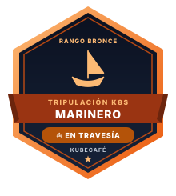 | `[](https://github.com/edwinbermudez91/Fundamentos-Kubernetes/tree/main/aportes-comunidad/soluciones-retos/TU-USUARIO)` |
| **🧭 Timonel K8s**<br><sub>🥈 Plata (2+ Semanas)</sub> | 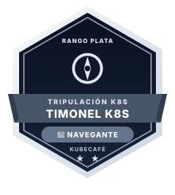 | `[](https://github.com/edwinbermudez91/Fundamentos-Kubernetes/tree/main/aportes-comunidad/soluciones-retos/TU-USUARIO)` |
| **⚓ Capitán K8s**<br><sub>🥇 Oro (6 Semanas)</sub> | 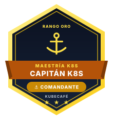 | `[](https://github.com/edwinbermudez91/Fundamentos-Kubernetes/tree/main/aportes-comunidad/soluciones-retos/TU-USUARIO)` |
| **🇨🇴 CNCF Medellín**<br><sub>Capítulo Oficial</sub> | 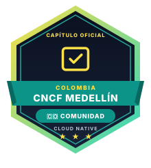 | `[](https://ocgroups.dev/cncf/group/2majk4r)` |

### 🧩 Insignias por Módulo Completado

<div align="center">
  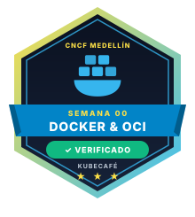
  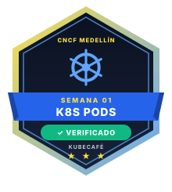
  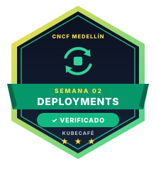
  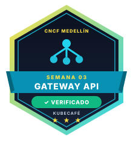
  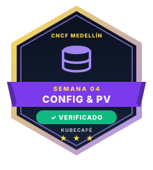
  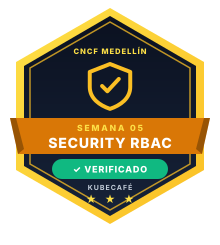
  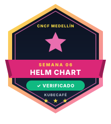
</div>

```html
<!-- Pega las insignias SVG de las semanas que ya completaste -->
<a href="https://github.com/edwinbermudez91/Fundamentos-Kubernetes/tree/main/aportes-comunidad/soluciones-retos/TU-USUARIO/semana-00">
  
</a>
<a href="https://github.com/edwinbermudez91/Fundamentos-Kubernetes/tree/main/aportes-comunidad/soluciones-retos/TU-USUARIO/semana-01">
  
</a>
```

---

## 📣 3. Comparte tu Progreso en Redes Sociales

Cada vez que llenas tu bitácora o entras a tu portafolio personal (`aportes-comunidad/soluciones-retos/<TU-USUARIO>/README.md`), encontrarás la sección de difusión profesional.

### 🚀 Publicar en LinkedIn con Alto Alcance (Recomendado)

> [!TIP]
> **¿Por qué copiar el texto, etiquetarnos y adjuntar imagen en LinkedIn?**  
> 1. **Espaciado protegido:** El texto usa separadores invisibles (`U+2800`) para que LinkedIn no junte los párrafos al pegar.  
> 2. **Etiqueta oficial (`@`):** LinkedIn no activa menciones al pegar texto plano. Al pegar, **borra y vuelve a escribir `@Cloud Native Colombia`** y selecciona **Cloud Native Colombia (Armenia, Bogota, Cali, Medellin)** en el menú desplegable para que tu post quede etiquetado.  
> 3. **Mayor visibilidad profesional:** Las publicaciones nativas con **texto + captura de pantalla** tienen hasta **10 veces más alcance** que compartir un enlace suelto.

#### Flujo en 3 Pasos:
1. **Copia la plantilla de texto** que está abajo (o la que se genera automáticamente con tu rango y XP en tu portafolio).
2. **Toma una captura de pantalla** de la cabecera de tu portafolio en GitHub (donde se ven tu banner, rango e insignias hexagonales).
3. **Haz clic en el botón de abajo**, pega el texto (`Ctrl+V` / `Cmd+V`), **etiqueta a `@Cloud Native Colombia (Armenia, Bogota, Cali, Medellin)`** y adjunta tu captura:

<div align="center">

[](https://www.linkedin.com/feed/?shareActive=true)

</div>

### 📝 Plantilla de Post de Alto Impacto para LinkedIn:

```text
☸️ ¡Semana [XX] superada en "De Cero a Capitán en Kubernetes" con la comunidad Cloud Native Medellín (CNCF)! 🏔️☕
⠀
Esta semana estuve practicando y resolviendo escenarios reales de Troubleshooting en contenedores y Kubernetes:
⠀
✅ [Escribe aquí tu aprendizaje #1, ej: Empaquetado seguro de imágenes Docker sin usuario root]
✅ [Escribe aquí tu aprendizaje #2, ej: Diagnóstico de Pods en CrashLoopBackOff y Pending con kubectl]
✅ [Escribe aquí tu aprendizaje #3, ej: Alta disponibilidad y Rolling Updates sin caídas con Deployments]
⠀
📂 Toda mi evidencia práctica, manifiestos corregidos y bitácora técnica están verificados por Cloud Native Medellín en mi portafolio de GitHub:
👉 https://github.com/edwinbermudez91/Fundamentos-Kubernetes/tree/main/aportes-comunidad/soluciones-retos/TU-USUARIO
⠀
Agradecimientos a @Cloud Native Colombia (Armenia, Bogota, Cali, Medellin) por este espacio de formación abierta:
⠀
🏢 LinkedIn: https://www.linkedin.com/company/cloud-native-colombia/
📸 Instagram: https://www.instagram.com/colombiacloudnative/
▶️ YouTube: https://www.youtube.com/@CloudNativeColombia
🔗 Capítulo oficial CNCF: https://ocgroups.dev/cncf/group/2majk4r
⠀
#Kubernetes #Docker #CloudNative #DevOps #SRE #CNCF #KubeCafe #OpenSource
```

### 🌐 Canales y otras Redes Sociales (1 Clic)

En WhatsApp y Telegram el mensaje y enlace se cargan automáticamente en 1 solo clic:

<div align="center">

[](https://api.whatsapp.com/send?text=%E2%98%B8%EF%B8%8F%20Estoy%20construyendo%20mi%20Portafolio%20Pr%C3%A1ctico%20de%20Docker%20y%20Kubernetes%20en%20el%20workshop%20De%20Cero%20a%20Capit%C3%A1n%20en%20Kubernetes%20%28CNCF%20Medell%C3%ADn%29%20%F0%9F%8F%94%EF%B8%8F%E2%98%95%20https%3A%2F%2Fgithub.com%2Fedwinbermudez91%2FFundamentos-Kubernetes)
[](https://t.me/share/url?url=https%3A%2F%2Fgithub.com%2Fedwinbermudez91%2FFundamentos-Kubernetes&text=%E2%98%B8%EF%B8%8F%20Portafolio%20Pr%C3%A1ctico%20de%20Docker%20y%20Kubernetes%20%E2%80%94%20Cloud%20Native%20Medell%C3%ADn%20%28CNCF%29)
[](https://www.instagram.com/colombiacloudnative/)
[](https://www.youtube.com/@CloudNativeColombia)
[](https://www.linkedin.com/company/cloud-native-colombia/)

</div>

---

## 💼 4. Cómo agregar este Portafolio a la sección "Proyectos" o "Destacados" de tu LinkedIn

Para que cualquier reclutador que visite tu perfil de LinkedIn vea tus laboratorios reales de Kubernetes:

1. Entra a tu perfil de **LinkedIn** y haz clic en **"Añadir sección"** → **"Recomendado"** → **"Añadir destacados"** (o **"Añadir proyecto"**).
2. Haz clic en el ícono **`+`** y selecciona **"Añadir un enlace"**.
3. Pega la dirección de tu portafolio personal:
   `https://github.com/edwinbermudez91/Fundamentos-Kubernetes/tree/main/aportes-comunidad/soluciones-retos/TU-USUARIO`
4. **Título sugerido:** `Portafolio Práctico de Docker y Kubernetes (KubeCafé — Cloud Native Medellín CNCF)`
5. **Descripción sugerida:** `Portafolio de ingeniería Cloud Native con laboratorios prácticos de contenedores, arquitectura de Kubernetes, resolución de incidentes reales (Troubleshooting) y bitácoras de navegación verificadas automáticamente con GitHub Actions.`
6. Haz clic en **Guardar**. ¡Ahora tu perfil tendrá evidencia técnica real y verificable!

