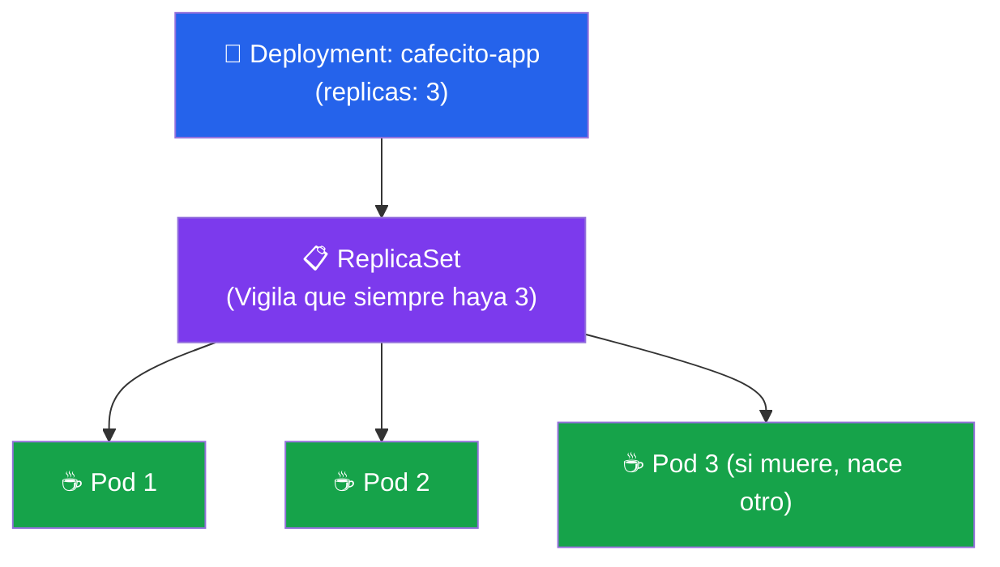
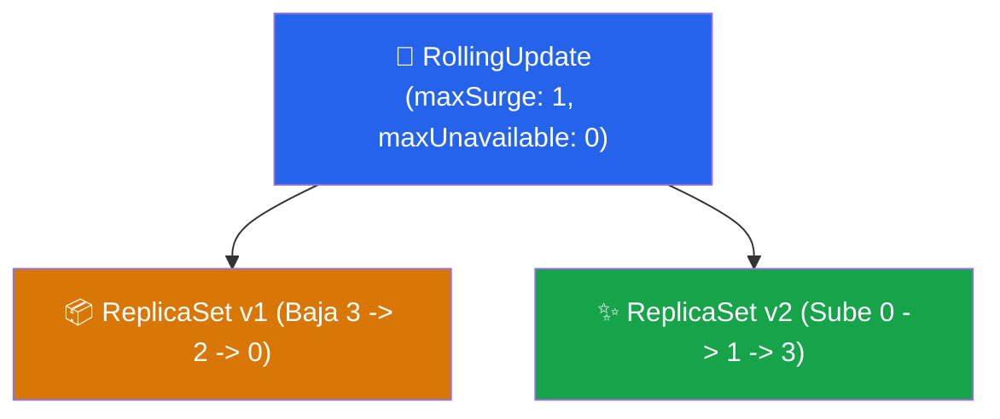

# 🧪 Ejemplos Prácticos de la Semana 02: Deployments y Auto-Curación

¡Bienvenido a la carpeta de laboratorios de la **Semana 02**! Aquí aprenderás a operar Kubernetes como se hace en las empresas reales: con **Deployments**, réplicas garantizadas, cero tiempo de inactividad (*Zero Downtime*) y recuperación automática de fallos (*Self-Healing*).

---

## 📦 Paso 0: Prepara tu Entorno (Clonar y Ruta de Trabajo)

Todos los comandos de esta semana se ejecutan desde la **raíz del repositorio (`Fundamentos-Kubernetes`)**:

```bash
# 1. Clonar el repositorio oficial del workshop
git clone https://github.com/edwinbermudez91/Fundamentos-Kubernetes.git

# 2. Entrar a la raíz del repositorio (ruta de trabajo)
cd Fundamentos-Kubernetes
```

---

## 📑 Índice de Ejemplos

| Manifiesto | Concepto Clave | Equivalente en ☕ KubeCafé |
| :--- | :--- | :--- |
| [`01-primer-deployment-replicas.yaml`](./01-primer-deployment-replicas.yaml) | ReplicaSet y coincidencia de etiquetas (`matchLabels`) | Orden permanente: *"Mantén siempre 3 bandejas listas"*. |
| [`02-rolling-update-cero-caidas.yaml`](./02-rolling-update-cero-caidas.yaml) | Estrategia `RollingUpdate`, `maxSurge` y `maxUnavailable` | Cambio de receta progresivo taza a taza sin parar el servicio. |
| [`03-estrategia-recreate.yaml`](./03-estrategia-recreate.yaml) | Estrategia `Recreate` (apagado total previo) | Cierre temporal de salón para remodelación o cambio de tubería. |
| [`04-deployment-con-recursos-y-probes.yaml`](./04-deployment-con-recursos-y-probes.yaml) | Probes, recursos y usuario no privilegiado | Estándar de calidad para servir en alta concurrencia. |
| [`05-deployment-ia-inferencia.yaml`](./05-deployment-ia-inferencia.yaml) | Microservicio de Inferencia de IA escalable | Barista Virtual recomendador de café con escalado horizontal. |

---

## 🚀 Laboratorio 1: Tu Primer Deployment y la Magia del Self-Healing



### Paso 1: Aplica el Deployment básico
```bash
kubectl apply -f $PWD/semana-02-deployments/1.ejemplos/01-primer-deployment-replicas.yaml
```

### Paso 2: Observa la jerarquía (Deployment ➔ ReplicaSet ➔ Pods)
Ejecuta este comando para ver cómo el Deployment controla al ReplicaSet y este a su vez a los 3 Pods:
```bash
kubectl get deployments,replicasets,pods -l app=cafecito
```

Verás una salida similar a:
```text
NAME                            READY   UP-TO-DATE   AVAILABLE   AGE
deployment.apps/cafecito-app    3/3     3            3           20s

NAME                                       DESIRED   CURRENT   READY   AGE
replicaset.apps/cafecito-app-6d8bfd8858    3         3         3       20s

NAME                                READY   STATUS    RESTARTS   AGE
pod/cafecito-app-6d8bfd8858-4k2lp   1/1     Running   0          20s
pod/cafecito-app-6d8bfd8858-9x7zm   1/1     Running   0          20s
pod/cafecito-app-6d8bfd8858-m8p1q   1/1     Running   0          20s
```

### Paso 3: ¡El experimento del Self-Healing! 🔥
En otra terminal o en la misma, copia el nombre de uno de los 3 Pods y bórralo a la fuerza:
```bash
kubectl delete pod cafecito-app-6d8bfd8858-4k2lp
```
De inmediato corre:
```bash
kubectl get pods -l app=cafecito
```
**¿Qué ocurrió?**  
El Pod que borraste dice `Terminating`, pero **en menos de 1 segundo nació un Pod nuevo** con otro nombre para mantener la promesa de las **3 réplicas** activas. ¡Esto es lo que salva a las empresas en incidentes de madrugada!

---

## 📈 Laboratorio 2: Escalado Horizontal en Vivo (Hora Pico en KubeCafé)

¿Llegó la hora pico de la tarde y necesitamos duplicar la capacidad de atención?

### Forma Imperativa (Rápida en terminal):
```bash
kubectl scale deployment cafecito-app --replicas=6
```
Revisa las 6 bandejas naciendo:
```bash
kubectl get pods -l app=cafecito -w
```

### Forma Declarativa (Buena práctica en producción):
Abre `01-primer-deployment-replicas.yaml`, cambia `replicas: 3` a `replicas: 4` y aplica:
```bash
kubectl apply -f $PWD/semana-02-deployments/1.ejemplos/01-primer-deployment-replicas.yaml
```

---

## 🔄 Laboratorio 3: Rolling Update (Actualización con Cero Caídas)



Aplica el Deployment con estrategia `RollingUpdate`:
```bash
kubectl apply -f $PWD/semana-02-deployments/1.ejemplos/02-rolling-update-cero-caidas.yaml
```

Verifica que esté corriendo con 4 réplicas:
```bash
kubectl get pods -l app=api-pedidos
```

### Simulando la actualización de versión:
Imagina que construiste la versión `v2.0`. Para actualizar en caliente sin detener el tráfico:
```bash
kubectl set env deployment/api-pedidos-rolling VERSION=v2.0
```
Mira en tiempo real cómo Kubernetes va apagando una taza vieja y encendiendo una nueva:
```bash
kubectl rollout status deployment/api-pedidos-rolling
```

### Consultando el historial de versiones:
```bash
kubectl rollout history deployment/api-pedidos-rolling
```

---

## 🚨 Laboratorio 4: El Botón de Pánico (*Rollback* en 3 Segundos)

¿Qué pasa si la versión nueva tenía un bug y la app empieza a fallar en producción?

Simulemos un error desplegando una imagen que no existe:
```bash
kubectl set image deployment/api-pedidos-rolling api=python:imagen-fantasma-999
```

Revisa el estado:
```bash
kubectl rollout status deployment/api-pedidos-rolling
```
Verás que el despliegue se queda atascado porque `maxUnavailable: 0` le prohíbe apagar los Pods sanos viejos. ¡Tus usuarios siguen viendo la versión anterior y nadie sufrió la caída!

### Ejecuta el Rollback inmediato:
```bash
kubectl rollout undo deployment/api-pedidos-rolling
```
¡Listo! Kubernetes revierte de inmediato a la última revisión estable que funcionaba:
```bash
kubectl rollout status deployment/api-pedidos-rolling
```

---

## 🧹 Laboratorio 5: Estrategia `Recreate` (`03-estrategia-recreate.yaml`)

A diferencia de `RollingUpdate`, la estrategia `Recreate` apaga todos los Pods antiguos **antes** de crear los nuevos (útil para migraciones de base de datos o volúmenes exclusivos `ReadWriteOnce`).

```bash
kubectl apply -f $PWD/semana-02-deployments/1.ejemplos/03-estrategia-recreate.yaml
kubectl get pods -l app=batch-procesador
```

Prueba actualizar la imagen o el comando y observa en vivo cómo terminan primero las 2 réplicas antes de nacer las nuevas:
```bash
kubectl set image deployment/batch-procesador-recreate worker=busybox:1.36
kubectl get pods -l app=batch-procesador -w
```

---

## 🛡️ Laboratorio 6: Estándar de Producción (`04-deployment-con-recursos-y-probes.yaml`)

Este manifiesto (`portal-clientes-prod`) combina **usuario no-root (`10001`)**, `requests`/`limits`, variables de entorno y sondas `livenessProbe` / `readinessProbe`:

```bash
kubectl apply -f $PWD/semana-02-deployments/1.ejemplos/04-deployment-con-recursos-y-probes.yaml
kubectl get pods -l app=portal-clientes
```

Verifica que el contenedor no corre como `root` y prueba el portal web:
```bash
# Comprobar usuario no privilegiado (uid=10001):
kubectl exec deployment/portal-clientes-prod -- id

# Abrir túnel hacia el puerto 8080 del contenedor unprivileged:
kubectl port-forward deployment/portal-clientes-prod 8080:8080
```
Abre **[http://localhost:8080](http://localhost:8080)** en tu navegador para confirmar que Nginx responde correctamente.

---

## 🤖 Laboratorio 7: Barista IA (Inferencia Escalable)

Aplica el Deployment del Barista Virtual de KubeCafé:
```bash
kubectl apply -f $PWD/semana-02-deployments/1.ejemplos/05-deployment-ia-inferencia.yaml
```

Abre un túnel hacia una de las réplicas:
```bash
kubectl port-forward deployment/barista-ia 8080:8080
```

Prueba pedir recomendaciones en tu terminal o navegador:
```bash
curl http://localhost:8080/
```
Respuesta esperada:
```json
{
  "modelo": "KubeCafe-Barista-AI-v1",
  "pod": "barista-ia-5f8cb47d9f-x9j2",
  "recomendacion": "Te recomiendo un Expreso doble con granos de origen Huila (tueste medio).",
  "latencia_inferencia_ms": 18.4,
  "timestamp": 1793836800.0
}
```
Si escalas el deployment con `kubectl scale deployment barista-ia --replicas=5`, tendrás un clúster de microservicios de IA balanceado y altamente disponible.

---

## 🧹 Limpieza del Laboratorio
Cuando termines de practicar, puedes eliminar los deployments creados:
```bash
kubectl delete -f $PWD/semana-02-deployments/1.ejemplos/
```

