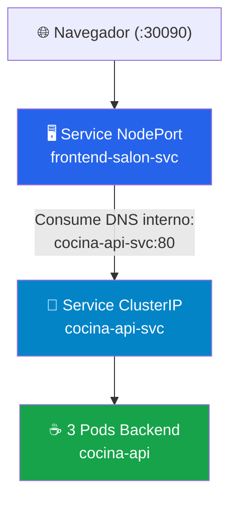
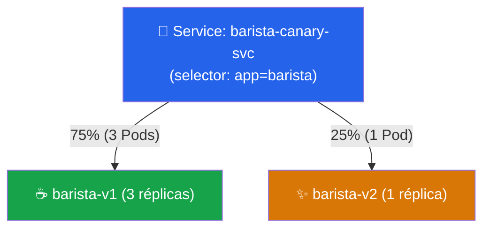
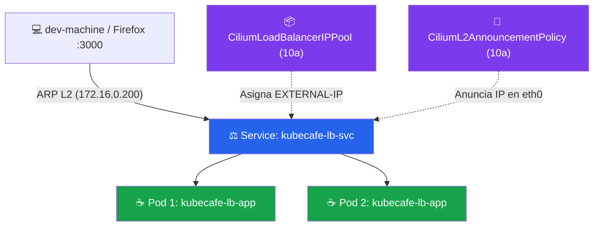
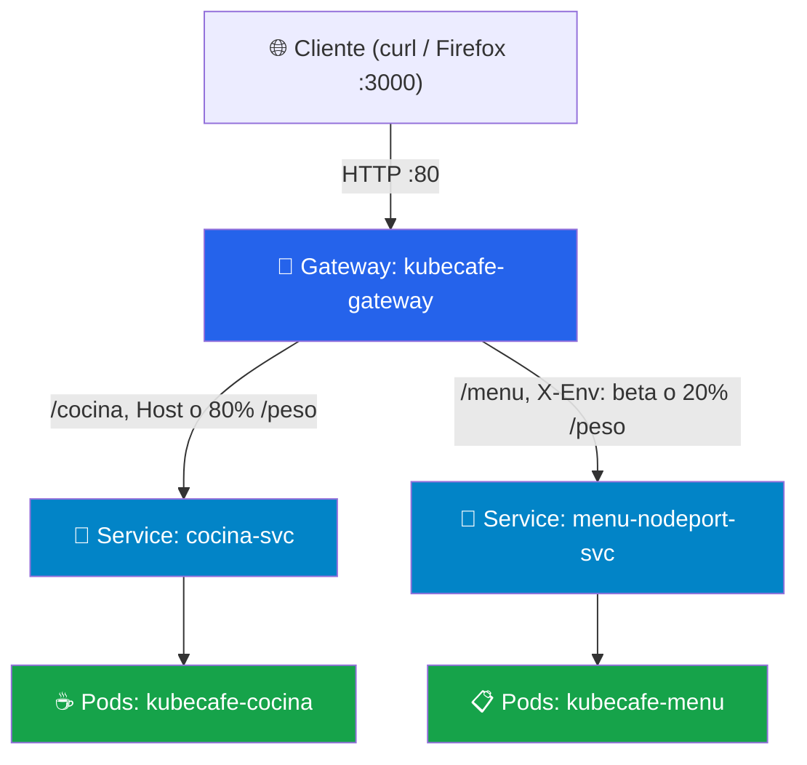
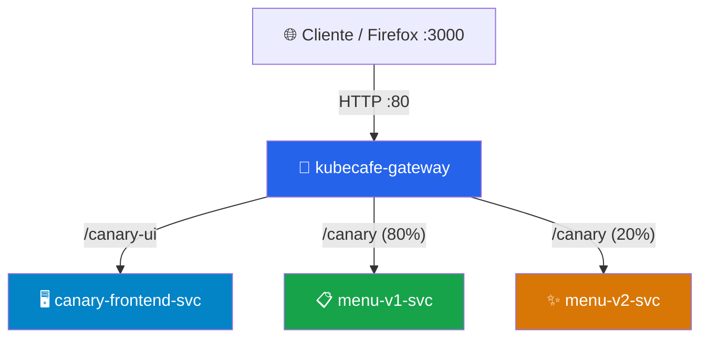
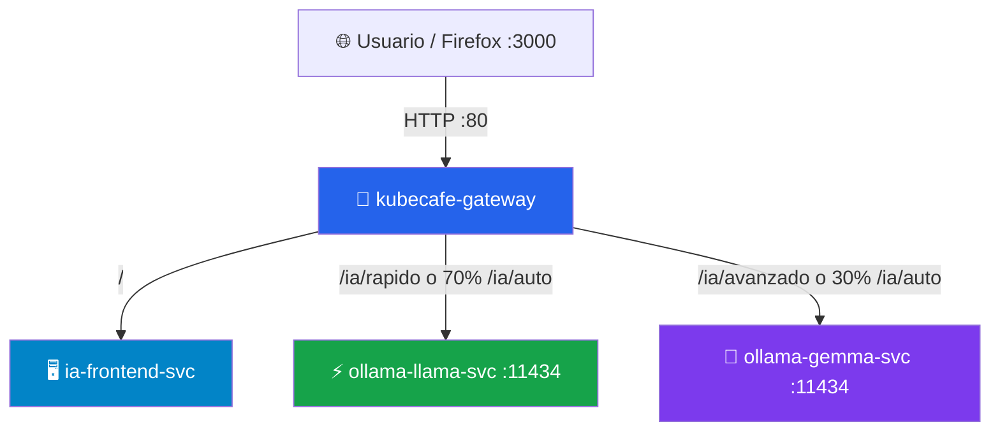
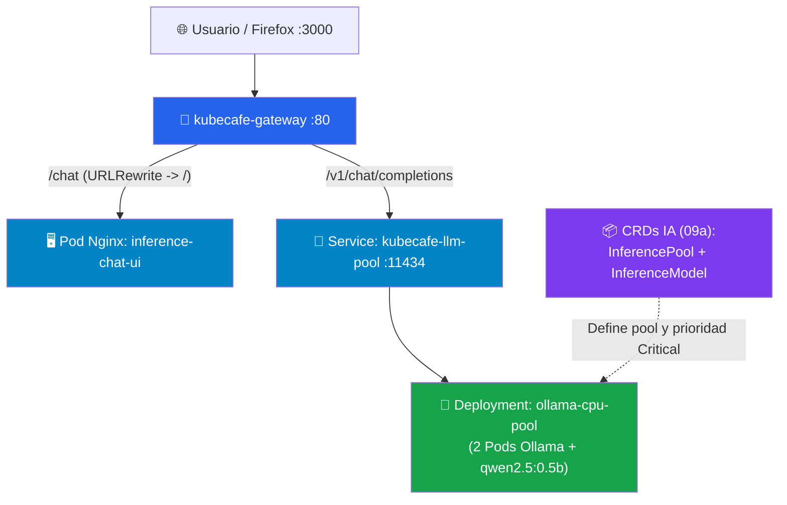

# 🧪 Ejemplos Prácticos de la Semana 03: Services, CoreDNS y Gateway API

¡Bienvenido a los laboratorios de redes de la **Semana 03**! Aquí conectarás tus Deployments de forma interna y externa sin depender nunca de las IPs cambiantes de los Pods.

---

## 📦 Paso 0: Prepara tu Entorno (Clonar y Ruta de Trabajo)

Todos los comandos de esta semana se ejecutan desde la **raíz del repositorio (`Fundamentos-Kubernetes`)**:

```bash
# 1. Clonar el repositorio oficial del workshop
git clone https://github.com/edwinbermudez91/Fundamentos-Kubernetes.git

# 2. Entrar a la raíz del repositorio (ruta de trabajo)
cd Fundamentos-Kubernetes
```

---

## 📑 Índice de Ejemplos

| Manifiesto | Concepto Clave | Equivalente en ☕ KubeCafé |
| :--- | :--- | :--- |
| [`01-service-clusterip-interno.yaml`](./01-service-clusterip-interno.yaml) | `Service` tipo `ClusterIP` y `Endpoints` | Mesero interno atendiendo pedidos hacia la cocina. |
| [`02-service-nodeport-externo.yaml`](./02-service-nodeport-externo.yaml) | `Service` tipo `NodePort` (`30080`) | Ventanilla directa hacia la calle en un puerto fijo. |
| [`03-dns-interno-coredns.yaml`](./03-dns-interno-coredns.yaml) | Descubrimiento con `CoreDNS` entre namespaces | Llamar por nombre (`cocina-svc.default.svc.cluster.local`). |
| [`04-gateway-api-httproute.yaml`](./04-gateway-api-httproute.yaml) | `Gateway` y `HTTPRoute` (Gateway API) | Puerta principal y recepcionista enrutando `/cocina` y `/menu`. |
| [`04b-httproute-por-dominio.yaml`](./04b-httproute-por-dominio.yaml) | `HTTPRoute` por `hostnames` | Enruta peticiones con dominio `cocina.kubecafe.local`. |
| [`04c-httproute-por-header.yaml`](./04c-httproute-por-header.yaml) | `HTTPRoute` por `headers` | Enruta `/beta` según el header `X-Env: beta`. |
| [`04d-httproute-canary-peso.yaml`](./04d-httproute-canary-peso.yaml) | `HTTPRoute` Canary por `weight` | Divide `/peso` en `80%` cocina y `20%` menú. |
| [`05-frontend-nodeport-backend-clusterip.yaml`](./05-frontend-nodeport-backend-clusterip.yaml) | Frontend (`NodePort`) ➔ Backend (`ClusterIP`) | Salón abierto al público conectado internamente con la API de cocina. |
| [`06-canary-solo-service.yaml`](./06-canary-solo-service.yaml) | Canary Deployment con solo `Service` (`75% / 25%`) | 3 baristas con receta v1 + 1 barista probando receta v2 bajo el mismo Mesero. |
| [`07-gateway-canary-deployment.yaml`](./07-gateway-canary-deployment.yaml) | Canary Deployment con `Gateway API` (`weight: 80/20`) | La recepcionista (`HTTPRoute`) envía 80% de clientes a v1 y 20% a v2. |
| [`08-gateway-ia-ollama-modelos.yaml`](./08-gateway-ia-ollama-modelos.yaml) | Frontend + `Gateway API` ➔ 2 Modelos IA (Ollama) | Selector web que enruta `/ia/rapido` o `/ia/avanzado` a distintos modelos. |
| [`09a-crds-inference-extension.yaml`](./09a-crds-inference-extension.yaml) | **CRDs:** `InferencePool` e `InferenceModel` | Registra las definiciones de recursos para IA en el clúster. |
| [`09-bonus-gateway-inference-extension.yaml`](./09-bonus-gateway-inference-extension.yaml) | **Bonus:** `Gateway API Inference Extension` (`CPU`) | `InferencePool` + `InferenceModel` enrutando `/v1/chat/completions` por modelo. |
| [`09b-frontend-inference-chat.yaml`](./09b-frontend-inference-chat.yaml) | **Frontend Web:** Chat IA en `/chat` | Interfaz web Nginx que envía peticiones `POST /v1/chat/completions` al Gateway. |
| [`10a-cilium-ippool-l2.yaml`](./10a-cilium-ippool-l2.yaml) | `CiliumLoadBalancerIPPool` + `CiliumL2AnnouncementPolicy` | Configura el rango `172.16.0.200–240` y anuncios L2 en `eth0`. |
| [`10b-service-loadbalancer-app.yaml`](./10b-service-loadbalancer-app.yaml) | `Deployment` + `Service` `LoadBalancer` | App web KubeCafé expuesta en `EXTERNAL-IP` sin `NodePort`. |

---

## 🌐 Laboratorio 1: Service `ClusterIP`, `Endpoints` y `EndpointSlices`

### Paso 1: Despliega la cocina y su Service interno
```bash
kubectl apply -f semana-03-services-gateway/1.ejemplos/01-service-clusterip-interno.yaml
```

### Paso 2: Verifica el Service, sus Endpoints y EndpointSlices
```bash
kubectl get svc cocina-svc
kubectl get endpoints cocina-svc
kubectl get endpointslices -l kubernetes.io/service-name=cocina-svc
kubectl get pods -l app=kubecafe-cocina -o wide
```
> 💡 **Observa:** Las IPs que aparecen en `Endpoints` y en `EndpointSlices` coinciden exactamente con las IPs de los 2 Pods de `kubecafe-cocina`. Si borras un Pod, Kubernetes actualiza la lista automáticamente.
>
> 📌 **¿Por qué existen ambos?** `Endpoints` es el objeto clásico (un único recurso para todas las IPs del Service, lo que se vuelve pesado cuando hay miles de Pods). **`EndpointSlices`** es su sucesor moderno en Kubernetes: divide los destinos en fragmentos más pequeños y eficientes para `kube-proxy` y el plano de control.

---

## 🚪 Laboratorio 2: Exposición Directa con `NodePort`

### Paso 1: Despliega el menú web y el Service NodePort
```bash
kubectl apply -f semana-03-services-gateway/1.ejemplos/02-service-nodeport-externo.yaml
```

### Paso 2: Verifica los 3 puertos y prueba desde cada Nodo
```bash
kubectl get svc menu-nodeport-svc
kubectl describe svc menu-nodeport-svc
```
> 💡 **Los 3 puertos del `NodePort`:**
> - `port: 80` ➔ Puerto interno del `Service` (`ClusterIP`).
> - `targetPort: 80` ➔ Puerto donde escucha el contenedor dentro del `Pod`.
> - `nodePort: 30080` ➔ Puerto abierto en **todos los nodos** del clúster (rango válido: `30000–32767`).

Obtén la IP de cada nodo del clúster y haz `curl` contra **cualquier nodo** (aunque el Pod no esté corriendo en ese nodo, `kube-proxy`/Cilium redirige el tráfico):
```bash
# 1. Ver las IPs internas de todos los nodos (control-plane y workers)
kubectl get nodes -o wide

# 2. Probar con curl usando la INTERNAL-IP de cada nodo:
curl -i http://<IP-NODO-1>:30080
curl -i http://<IP-NODO-2>:30080

# 3. En un solo comando para probar todos los nodos automáticamente:
for ip in $(kubectl get nodes -o jsonpath='{.items[*].status.addresses[?(@.type=="InternalIP")].address}'); do
  echo "Probando nodo $ip:30080..."
  curl -s -o /dev/null -w "HTTP %{http_code}\n" http://$ip:30080
done
```
*(Si usas **Kind** o **Docker Desktop** en macOS/Windows y las IPs internas de los nodos no son alcanzables desde tu host, usa `kubectl port-forward svc/menu-nodeport-svc 8081:80` y abre `http://localhost:8081`).*

---

## 🧭 Laboratorio 3: Descubrimiento DNS con `CoreDNS` (Cross-Namespace)

### Paso 1: Despliega el Pod cliente en otro Namespace (`kubecafe-salon`)
```bash
kubectl apply -f semana-03-services-gateway/1.ejemplos/03-dns-interno-coredns.yaml
kubectl wait --for=condition=Ready pod/mesero-tester -n kubecafe-salon --timeout=60s
```

### Paso 2: Prueba la resolución DNS y los FQDNs entre Namespaces
Desde `kubecafe-salon`, revisa primero cómo resuelve DNS el Pod y luego prueba cada nivel del FQDN hacia `cocina-svc` (que vive en `default`):
```bash
# 0. Inspecciona la configuración DNS inyectada por CoreDNS/kubelet:
kubectl exec -n kubecafe-salon mesero-tester -- cat /etc/resolv.conf

# 1. Nombre corto falla porque busca en kubecafe-salon.svc.cluster.local:
kubectl exec -n kubecafe-salon mesero-tester -- curl -s --max-time 3 http://cocina-svc || echo "Falla sin namespace"

# 2. Usando <service>.<namespace> funciona (curl -v muestra la IP resuelta por CoreDNS):
kubectl exec -n kubecafe-salon mesero-tester -- curl -s http://cocina-svc.default

# 3. Usando <service>.<namespace>.svc:
kubectl exec -n kubecafe-salon mesero-tester -- curl -s http://cocina-svc.default.svc

# 4. Usando el FQDN completo de Kubernetes (<service>.<namespace>.svc.cluster.local):
kubectl exec -n kubecafe-salon mesero-tester -- curl -v http://cocina-svc.default.svc.cluster.local
```

---

## ⚡ Laboratorio 4: Modo Imperativo Paso a Paso (Sin escribir YAML)

Si quieres practicar rápido en terminal o en un examen (CKA/CKAD), puedes crear toda la arquitectura de Services y probar el FQDN usando **solo comandos imperativos**:

### Paso 1: Crear el Deployment de la cocina
```bash
kubectl create deployment cocina-imp --image=nginx:alpine --replicas=2 --port=80
kubectl rollout status deployment/cocina-imp
```

### Paso 2: Exponer el Deployment con un Service `ClusterIP`
```bash
kubectl expose deployment cocina-imp --name=cocina-imp-svc --port=80 --target-port=80 --type=ClusterIP
kubectl get svc cocina-imp-svc
kubectl get endpointslices -l kubernetes.io/service-name=cocina-imp-svc
```

### Paso 3: Exponer otro Service como `NodePort`
```bash
kubectl expose deployment cocina-imp --name=cocina-imp-nodeport --port=80 --target-port=80 --type=NodePort
kubectl get svc cocina-imp-nodeport
```

### Paso 4: Crear un Namespace y probar el FQDN con un Pod temporal
Primero creamos un Namespace aparte (`salon-imp`) para probar cómo se comunican Pods que están en **diferentes Namespaces**:
```bash
kubectl create namespace salon-imp
```

> 💡 **¿Qué hace cada opción de `kubectl run`?**
> - `-n salon-imp` ➔ Crea el Pod temporal dentro del Namespace `salon-imp`.
> - `--rm --attach --restart=Never` ➔ Ejecuta el comando, muestra el resultado en tu terminal y **borra el Pod automáticamente** al terminar.
> - `curl -I` ➔ Pide solo las cabeceras HTTP para confirmar si respondió `200 OK`.

1. **Prueba sin namespace (falla a propósito):** busca `cocina-imp-svc` dentro de `salon-imp`, donde no existe.
   ```bash
   kubectl run tester-1 -n salon-imp --image=curlimages/curl:8.10.1 --rm --attach --restart=Never -- \
     curl -I --max-time 2 http://cocina-imp-svc
   ```
   *Respuesta esperada:* `Could not resolve host: cocina-imp-svc` (error esperado porque el Service vive en `default`).

2. **Prueba con `<service>.<namespace>`:** indica explícitamente que el Service está en `default`.
   ```bash
   kubectl run tester-2 -n salon-imp --image=curlimages/curl:8.10.1 --rm --attach --restart=Never -- \
     curl -I http://cocina-imp-svc.default
   ```
   *Respuesta esperada:* `HTTP/1.1 200 OK`.

3. **Prueba con el FQDN completo (`<service>.<namespace>.svc.cluster.local`):** es el nombre DNS oficial completo dentro del clúster.
   ```bash
   kubectl run tester-3 -n salon-imp --image=curlimages/curl:8.10.1 --rm --attach --restart=Never -- \
     curl -I http://cocina-imp-svc.default.svc.cluster.local
   ```
   *Respuesta esperada:* `HTTP/1.1 200 OK`.

### Paso 5: Exportar a YAML si lo quieres guardar como manifiesto
```bash
kubectl create deployment cocina-imp --image=nginx:alpine --replicas=2 --port=80 --dry-run=client -o yaml > cocina-imp.yaml
kubectl expose deployment cocina-imp --name=cocina-imp-svc --port=80 --target-port=80 --dry-run=client -o yaml >> cocina-imp.yaml
```

### Paso 6: Limpiar recursos imperativos
```bash
kubectl delete svc cocina-imp-svc cocina-imp-nodeport --ignore-not-found
kubectl delete deployment cocina-imp --ignore-not-found
kubectl delete namespace salon-imp --ignore-not-found
```

---

## 🔗 Laboratorio 5 (Integrador): Frontend (`NodePort`) ➔ Backend (`ClusterIP` + FQDN)



Este ejercicio conecta una arquitectura real de 2 capas:
1. **Backend (`api-backend-svc` · `ClusterIP`):** solo accesible dentro del clúster.
2. **Frontend (`web-frontend-svc` · `NodePort :30090`):** expuesto hacia afuera; cuando recibe `/api`, reenvía la petición al Backend usando su FQDN interno (`http://api-backend-svc.default.svc.cluster.local`).

### Paso 1: Aplica el Backend (`ClusterIP`) y Frontend (`NodePort`)
```bash
kubectl apply -f semana-03-services-gateway/1.ejemplos/05-frontend-nodeport-backend-clusterip.yaml
```

### Paso 2: Verifica ambos Services y sus `EndpointSlices`
```bash
# 1. Confirmar que api-backend-svc es ClusterIP y web-frontend-svc es NodePort (:30090):
kubectl get svc api-backend-svc web-frontend-svc

# 2. Confirmar que el Backend tiene 3 Pods conectados y el Frontend 2 Pods:
kubectl get endpointslices -l 'kubernetes.io/service-name in (api-backend-svc, web-frontend-svc)'
```

### Paso 3: Prueba el flujo completo (Frontend `:30090` ➔ Backend `ClusterIP`)
```bash
# 1. Obtener la IP interna de un nodo del clúster:
NODE_IP=$(kubectl get nodes -o jsonpath='{.items[0].status.addresses[?(@.type=="InternalIP")].address}')

# 2. Hacer 6 peticiones a /api (el Frontend reenvía al Backend vía FQDN interno):
for i in {1..6}; do
  curl -s http://$NODE_IP:30090/api
done
```
> 💡 **Respuesta esperada:** Verás 6 líneas JSON como `{"cafeteria":"KubeCafe","backend_pod":"api-backend-..."}` donde **`backend_pod` cambia entre las 3 réplicas**, demostrando el balanceo de carga del Service `ClusterIP`. También puedes abrir `http://$NODE_IP:30090/` en Firefox (iximiuz puerto `3000`) y hacer clic en **`🚀 Llamar a /api`**.
> *(En Kind/Docker Desktop en macOS/Windows: `kubectl port-forward svc/web-frontend-svc 8090:80` y abre `http://localhost:8090/`).*

---

## 🐤 Laboratorio 6: Canary Deployment con solo `Service` (`75% v1` / `25% v2`)



No siempre necesitas un Gateway o Service Mesh para hacer pruebas **Canary**: un simple `Service` cuyo `selector` (`app: barista`) coincida con **dos Deployments** (`barista-v1` con 3 réplicas y `barista-v2-canary` con 1 réplica) repartirá el tráfico proporcionalmente según el número de Pods (`75%` vs `25%`).

### Paso 1: Aplica ambos Deployments y el Service compartido
```bash
kubectl apply -f semana-03-services-gateway/1.ejemplos/06-canary-solo-service.yaml
kubectl get pods -l app=barista --show-labels
kubectl get endpointslices -l kubernetes.io/service-name=barista-canary-svc
```

### Paso 2: Prueba el reparto de tráfico (v1 vs v2)
```bash
kubectl run canary-tester --image=curlimages/curl:8.10.1 --rm --attach --restart=Never -- \
  sh -c 'sleep 1; for i in $(seq 1 12); do printf "%2d) " $i; curl -s http://barista-canary-svc; done'
```
> 💡 **Observa:** Aproximadamente 3 de cada 4 respuestas vendrán de `v1.0` y 1 de cada 4 de `v2.0 (Canary)`. Si `v2.0` funciona bien, escalas `barista-v2-canary` y reduces `barista-v1`:
> ```bash
> kubectl scale deployment barista-v2-canary --replicas=3
> kubectl scale deployment barista-v1 --replicas=0
> ```

---

## ⚖️ Laboratorio 7: Service `LoadBalancer` con Cilium (`IPPool` + `L2 Announcements`)



En un clúster propio o en **iximiuz Kubernetes Cluster Playground** (red `172.16.0.0/24` sobre `eth0`), un `Service` de tipo `LoadBalancer` queda en `<pending>` a menos que un controlador asigne IPs. **Cilium** puede asignar IPs de un rango y anunciarlas en la red local.

### 🧩 ¿Qué hace cada recurso que vamos a desplegar?
1. **`CiliumLoadBalancerIPPool` (`10a-cilium-ippool-l2.yaml`):** Es la "caja de IPs disponibles" (`172.16.0.200` a `172.16.0.240`) de donde Cilium toma una `EXTERNAL-IP` libre cuando creas un `Service` `LoadBalancer`.
2. **`CiliumL2AnnouncementPolicy` (`10a-cilium-ippool-l2.yaml`):** Le indica a Cilium en qué interfaz de red (`eth0`) debe anunciar por ARP (*"yo tengo esta IP"*) para que `dev-machine` y la red del clúster puedan llegar a ella.
3. **`Deployment` (`10b-service-loadbalancer-app.yaml`):** Levanta 2 Pods con una página web KubeCafé que muestra qué Pod exacto responde.
4. **`Service` `type: LoadBalancer` (`10b-service-loadbalancer-app.yaml`):** Recibe una `EXTERNAL-IP` del Pool y reparte el tráfico entre los 2 Pods. Con `allocateLoadBalancerNodePorts: false` evitamos que Kubernetes abra un puerto `NodePort` adicional innecesario.

### Paso 1: Verifica si Cilium tiene habilitado L2 Announcements
```bash
cilium config view | grep -E "enable-l2-announcements|l2-pod-announcements"
```
Si `enable-l2-announcements` no aparece en `true`, agrega el repositorio oficial de Helm de Cilium y habilítalo:
```bash
helm repo add cilium https://helm.cilium.io/
helm repo update

helm upgrade cilium cilium/cilium \
  --namespace kube-system \
  --reuse-values \
  --set l2announcements.enabled=true \
  --set externalIPs.enabled=true

kubectl -n kube-system rollout restart deployment/cilium-operator
kubectl -n kube-system rollout restart daemonset/cilium

# Esperar y corroborar que todos los componentes de Cilium estén OK:
cilium status --wait
```
> 📚 **Documentación oficial y práctica de Cilium:** [LoadBalancer IPAM](https://docs.cilium.io/en/stable/network/lb-ipam/) • [L2 Announcements (ARP)](https://docs.cilium.io/en/stable/network/l2-announcements/) • [Gateway API en Cilium](https://docs.cilium.io/en/stable/network/servicemesh/gateway-api/gateway-api/) • [🐝 Ejercicios Interactivos de Cilium (Isovalent Labs)](https://labs.isovalent.com/#/overview)

### Paso 2: Aplica primero la configuración de Cilium (`IPPool` + `L2 Policy`) y luego la App (`LoadBalancer`)
```bash
# 1. Configurar rango de IPs y política L2 en Cilium:
kubectl apply -f semana-03-services-gateway/1.ejemplos/10a-cilium-ippool-l2.yaml
kubectl get ciliumloadbalancerippool,ciliuml2announcementpolicy

# 2. Desplegar la aplicación y su Service LoadBalancer (sin NodePort):
kubectl apply -f semana-03-services-gateway/1.ejemplos/10b-service-loadbalancer-app.yaml
kubectl get svc kubecafe-lb-svc
```
> 💡 En unos segundos, la columna `EXTERNAL-IP` de `kubecafe-lb-svc` mostrará una IP del rango (por ejemplo `172.16.0.200`).

### Paso 3: Prueba el acceso directo a la `EXTERNAL-IP`
Desde `dev-machine` (o cualquier nodo en la red `172.16.0.0/24`):
```bash
# 1. Guardar la IP externa asignada por Cilium (ej. 172.16.0.200):
LB_IP=$(kubectl get svc kubecafe-lb-svc -o jsonpath='{.status.loadBalancer.ingress[0].ip}')
echo "IP del LoadBalancer: $LB_IP"

# 2. Verificar que responde HTTP 200 OK (solo cabeceras):
curl -I http://$LB_IP

# 3. Probar 6 peticiones seguidas mostrando qué Pod exacto responde cada vez:
for i in $(seq 1 6); do
  printf "Petición %d -> " "$i"
  curl -s http://$LB_IP | grep -o "kubecafe-lb-app-[a-z0-9-]*"
done
```
> 💡 **Respuesta esperada:**
> - En `curl -I` verás **`HTTP/1.1 200 OK`**.
> - En el bucle verás 6 líneas alternando entre los 2 Pods (`kubecafe-lb-app-...`), demostrando el balanceo de carga de Cilium L2.

### Paso 4 (Opcional en iximiuz): Ver la tarjeta web en el navegador (Firefox `:3000`)
Si estás en **iximiuz Labs** (`dev-machine`), levanta el contenedor de Firefox para abrir `http://$LB_IP` (ej. `http://172.16.0.200`) de forma visual (y reutilizarlo luego en los Labs 8, 9 y 10):
```bash
docker run -d --name firefox -p 3000:3000 --shm-size="1gb" lscr.io/linuxserver/firefox:latest
```
Luego abre el modal **Expose HTTP(S) Ports** en iximiuz:
- **Machine:** `dev-machine`
- **Port:** `3000`
- Haz clic en **EXPOSE**, abre la URL generada y entra a `http://172.16.0.200` (verás la tarjeta de KubeCafé y el botón **`🔄 Recargar para probar balanceo`**).

---

## 🏛️ Laboratorio 8: Enrutamiento HTTP Moderno con Gateway API (Cilium)



Este laboratorio utiliza **Cilium** (el CNI del clúster) como controlador nativo de **Gateway API** (`gatewayClassName: cilium`).

### Paso 1: Instalar los CRDs de Gateway API (v1.6.3) y habilitar Gateway API en Cilium
*(Basado en la [Documentación Oficial de Cilium Gateway API](https://docs.cilium.io/en/stable/network/servicemesh/gateway-api/gateway-api/))*

1. Instala los **7 CRDs requeridos** de Kubernetes Gateway API v1.6.3 (`--server-side`):
   ```bash
   kubectl apply --server-side -f https://raw.githubusercontent.com/kubernetes-sigs/gateway-api/v1.6.3/config/crd/standard/gateway.networking.k8s.io_gatewayclasses.yaml
   kubectl apply --server-side -f https://raw.githubusercontent.com/kubernetes-sigs/gateway-api/v1.6.3/config/crd/standard/gateway.networking.k8s.io_gateways.yaml
   kubectl apply --server-side -f https://raw.githubusercontent.com/kubernetes-sigs/gateway-api/v1.6.3/config/crd/standard/gateway.networking.k8s.io_httproutes.yaml
   kubectl apply --server-side -f https://raw.githubusercontent.com/kubernetes-sigs/gateway-api/v1.6.3/config/crd/standard/gateway.networking.k8s.io_referencegrants.yaml
   kubectl apply --server-side -f https://raw.githubusercontent.com/kubernetes-sigs/gateway-api/v1.6.3/config/crd/standard/gateway.networking.k8s.io_grpcroutes.yaml
   kubectl apply --server-side -f https://raw.githubusercontent.com/kubernetes-sigs/gateway-api/v1.6.3/config/crd/standard/gateway.networking.k8s.io_backendtlspolicies.yaml
   kubectl apply --server-side -f https://raw.githubusercontent.com/kubernetes-sigs/gateway-api/v1.6.3/config/crd/standard/gateway.networking.k8s.io_tlsroutes.yaml
   ```
   *(Opcional — para habilitar soporte de `ListenerSet`, `TCPRoute` y `UDPRoute` en Cilium):*
   ```bash
   kubectl apply --server-side -f https://raw.githubusercontent.com/kubernetes-sigs/gateway-api/v1.6.3/config/crd/standard/gateway.networking.k8s.io_listenersets.yaml
   kubectl apply --server-side -f https://raw.githubusercontent.com/kubernetes-sigs/gateway-api/v1.6.3/config/crd/standard/gateway.networking.k8s.io_tcproutes.yaml
   kubectl apply --server-side -f https://raw.githubusercontent.com/kubernetes-sigs/gateway-api/v1.6.3/config/crd/standard/gateway.networking.k8s.io_udproutes.yaml
   ```
2. Agrega el repositorio oficial de Helm de Cilium, habilita `kubeProxyReplacement=true` y `gatewayAPI.enabled=true`, y reinicia el operador y el DaemonSet:
   ```bash
   helm repo add cilium https://helm.cilium.io/
   helm repo update

   helm upgrade cilium cilium/cilium \
     --namespace kube-system \
     --reuse-values \
     --set kubeProxyReplacement=true \
     --set gatewayAPI.enabled=true

   kubectl -n kube-system rollout restart deployment/cilium-operator
   kubectl -n kube-system rollout restart ds/cilium
   ```
3. Verifica el estado de Cilium y que `GatewayClass` muestre `ACCEPTED: True`:
   ```bash
   cilium status --wait
   kubectl get gatewayclass cilium
   ```

### Paso 2: Asegura los Deployments y Services base (Lab 1 y Lab 2) y aplica el Gateway + HTTPRoute
*(Este laboratorio reutiliza `iximiuz-pool` del **Lab 7** para recibir `EXTERNAL-IP`, y los Services `cocina-svc` del **Lab 1** y `menu-nodeport-svc` del **Lab 2** como backends)*:
```bash
# 1. Asegúrate de tener activos los Deployments y Services del Lab 1 y Lab 2:
kubectl apply -f semana-03-services-gateway/1.ejemplos/01-service-clusterip-interno.yaml
kubectl apply -f semana-03-services-gateway/1.ejemplos/02-service-nodeport-externo.yaml

# 2. Aplica el Gateway (Cilium) y el HTTPRoute (/cocina y /menu):
kubectl apply -f semana-03-services-gateway/1.ejemplos/04-gateway-api-httproute.yaml
kubectl get deploy,svc,gateway,httproute
```

### Paso 3: Probar las rutas `/cocina` y `/menu`
Obtén la IP asignada al Gateway (o usa `port-forward` si estás en un entorno local sin LoadBalancer):
```bash
GW_IP=$(kubectl get gateway kubecafe-gateway -o jsonpath='{.status.addresses[0].value}')
curl -I http://$GW_IP/cocina
curl -I http://$GW_IP/menu
```

### Paso 4: Más ejemplos de `HTTPRoute` (Hostnames, Headers y Canary por Peso)

Cada ejemplo tiene su propio manifiesto y su propia ruta para que puedas probarlos sin conflictos:

1. **Enrutamiento por dominio (`hostnames`)** — dirige peticiones que llegan con el dominio `cocina.kubecafe.local` hacia `cocina-svc`:
   ```bash
   kubectl apply -f semana-03-services-gateway/1.ejemplos/04b-httproute-por-dominio.yaml
   curl -s -H "Host: cocina.kubecafe.local" http://$GW_IP/ | grep -o "Cocina KubeCafé\|kubecafe-cocina-[a-z0-9-]*"
   ```
   > 💡 **Respuesta esperada:** Verás `Cocina KubeCafé` y el nombre del Pod `kubecafe-cocina-...` (sin necesidad de editar `/etc/hosts`, porque `curl -H "Host: ..."` simula el dominio).

2. **Enrutamiento por `headers` (Pruebas Beta / Feature Flags)** — en `/beta`, si la petición trae el header `X-Env: beta` va hacia `menu-nodeport-svc`; si no lo trae, va hacia `cocina-svc`:
   ```bash
   kubectl apply -f semana-03-services-gateway/1.ejemplos/04c-httproute-por-header.yaml

   # Petición normal (sin header) -> responde Cocina:
   curl -s http://$GW_IP/beta | grep -o "Cocina KubeCafé\|Menú KubeCafé"

   # Petición con header X-Env: beta -> responde Menú:
   curl -s -H "X-Env: beta" http://$GW_IP/beta | grep -o "Cocina KubeCafé\|Menú KubeCafé"
   ```
   > 💡 **Respuesta esperada:** Sin header verás **`Cocina KubeCafé`**; con `-H "X-Env: beta"` verás **`Menú KubeCafé`**.

3. **División de tráfico por pesos (`weight: 80` / `weight: 20`)** — en `/peso`, Cilium envía ~80% del tráfico a `cocina-svc` y ~20% a `menu-nodeport-svc`:
   ```bash
   kubectl apply -f semana-03-services-gateway/1.ejemplos/04d-httproute-canary-peso.yaml

   for i in $(seq 1 10); do
     printf "Petición %2d -> " "$i"
     curl -s http://$GW_IP/peso | grep -o "Cocina KubeCafé\|Menú KubeCafé"
   done
   ```
   > 💡 **Respuesta esperada:** Aproximadamente **8 respuestas** dirán **`Cocina KubeCafé`** y **2 respuestas** dirán **`Menú KubeCafé`**.

---

## 🚦 Laboratorio 9: Canary Deployment Fácil con Gateway API (`80%` / `20%`)



A diferencia del **Laboratorio 6** (donde el porcentaje dependía del número de Pods), con **Gateway API** puedes controlar el porcentaje exacto (`weight: 80` / `weight: 20`) sin importar cuántas réplicas tenga cada Deployment.

### Paso 1: Aplica los 2 Deployments, sus 2 Services y el `HTTPRoute`
*(Requiere tener `kubecafe-gateway` creado en el Laboratorio 8).*
```bash
kubectl apply -f semana-03-services-gateway/1.ejemplos/07-gateway-canary-deployment.yaml
kubectl get httproute menu-canary-route
```

### Paso 2: Prueba el reparto 80% / 20% en `/canary`
```bash
GW_IP=$(kubectl get gateway kubecafe-gateway -o jsonpath='{.status.addresses[0].value}')
for i in $(seq 1 10); do
  curl -s http://$GW_IP/canary
done
```
> 💡 **Observa:** Alrededor de 8 respuestas dirán `Menu v1.0 (Estable - 80%)` y 2 dirán `Menu v2.0 (Canary - 20%)`. Para pasar el 100% del tráfico a `v2`, solo cambia `weight: 0` en `menu-v1-svc` y `weight: 100` en `menu-v2-svc`.

---

## 🤖 Laboratorio 10: AI Gateway — Frontend con Gateway API consumiendo 2 Modelos de IA (Ollama)



En este laboratorio montas un **AI Gateway** en Kubernetes: un único punto de entrada (`Gateway` + `HTTPRoute`) donde un mismo **Frontend web** (`ia-frontend-svc`) consume **dos backends de IA distintos** en el puerto estándar de Ollama (`:11434`):
- `/ia/rapido` ➔ `ollama-llama-svc:11434` (`llama3.2:1b`)
- `/ia/avanzado` ➔ `ollama-gemma-svc:11434` (`gemma2:2b`)

> 💡 **¿Por qué usar un AI Gateway?** Te permite cambiar de modelo, hacer A/B testing con `weight`, o enrutar por header (`X-Model`) sin modificar el código del Frontend.

### Paso 1: Aplica el Frontend, los 2 Modelos y el `HTTPRoute`
*(Requiere tener `kubecafe-gateway` creado en el Laboratorio 8).*
```bash
kubectl apply -f semana-03-services-gateway/1.ejemplos/08-gateway-ia-ollama-modelos.yaml
kubectl get svc ia-frontend-svc ollama-llama-svc ollama-gemma-svc
kubectl get httproute kubecafe-ia-route
```

### Paso 2: Prueba ambos modelos desde terminal o navegador
```bash
GW_IP=$(kubectl get gateway kubecafe-gateway -o jsonpath='{.status.addresses[0].value}')

# 1. Probar el modelo rápido:
curl -s http://$GW_IP/ia/rapido

# 2. Probar el modelo avanzado:
curl -s http://$GW_IP/ia/avanzado
```
*(También puedes abrir `http://$GW_IP/` en tu navegador para usar los botones del selector de modelos).*

---

## 🌟 Bonus Lab: Gateway API Inference Extension (Lo nuevo en K8s para IA en CPU)

**Gateway API Inference Extension** (`InferencePool` + `InferenceModel`) es la extensión oficial de Kubernetes para servir LLMs: en lugar de balancear por IP como un `Service` clásico, el Gateway inspecciona el campo `"model"` del JSON y elige el Pod óptimo según carga y prioridad (`Critical` vs `Sheddable`). Todo esto funciona **100% en CPU** con modelos ligeros como `qwen2.5:0.5b`.

> 📚 **Referencias y Documentación Oficial:**
> - 🌐 [Sitio Oficial: Gateway API Inference Extension](https://gateway-api-inference-extension.sigs.k8s.io/)
> - 📰 [Blog de Kubernetes: Introducing Gateway API Inference Extension](https://kubernetes.io/blog/2025/06/05/introducing-gateway-api-inference-extension/)

### 🗺️ Arquitectura de los Componentes (Frontend + Gateway + Ollama + CRDs de IA)



- **¿Por qué no hay errores de CORS?** Porque tanto la página web (`/chat`) como la API de IA (`/v1/chat/completions`) entran por el mismo `kubecafe-gateway` (`http://$GW_IP`).
- **¿Qué papel juegan `InferencePool` e `InferenceModel`?** Registran en Kubernetes los recursos estándar de IA (qué modelo está disponible y su prioridad `Critical`), mientras que el `Service` `kubecafe-llm-pool` conecta la red de Cilium hacia los Pods de Ollama.

### Paso 1: Instala los CRDs de Gateway API Inference Extension

Antes de crear los recursos `InferencePool` e `InferenceModel`, el clúster de Kubernetes debe conocer sus definiciones personalizadas (CRDs). Aplícalos directamente desde el manifiesto local incluido en el repositorio (100% offline y sin depender de URLs externas):

```bash
kubectl apply -f semana-03-services-gateway/1.ejemplos/09a-crds-inference-extension.yaml
```

Verifica que los CRDs estén registrados en el clúster:
```bash
kubectl get crd | grep inference
```
*Salida esperada:*
```text
inferencemodels.inference.networking.x-k8s.io
inferencepools.inference.networking.x-k8s.io
```

### Paso 2: Aplica el Pool de Ollama en CPU, `InferencePool`, `InferenceModel`, `Service` y `HTTPRoute`
```bash
kubectl apply -f semana-03-services-gateway/1.ejemplos/09-bonus-gateway-inference-extension.yaml
kubectl get inferencepool,inferencemodel,httproute
kubectl get svc kubecafe-llm-pool
```

### Paso 3: Descarga el modelo ligero en los Pods y prueba `/v1/chat/completions`

> ⚠️ **Punto Clave:** Ollama necesita tener el modelo descargado localmente antes de poder responder la inferencia en su API OpenAI-compatible (`/v1/chat/completions`).

```bash
# 1. Espera a que los Pods de ollama estén en estado Running:
kubectl wait --for=condition=ready pod -l app=ollama-cpu --timeout=90s

# 2. Descarga qwen2.5:0.5b (~390 MB optimizado para CPU) en los Pods:
PODS=$(kubectl get pods -l app=ollama-cpu -o jsonpath='{.items[*].metadata.name}')
for pod in $PODS; do
  echo "Descargando modelo qwen2.5:0.5b en $pod..."
  kubectl exec $pod -- ollama pull qwen2.5:0.5b
done

# 3. Obtén la IP del Gateway y envía la inferencia:
GW_IP=$(kubectl get gateway kubecafe-gateway -o jsonpath='{.status.addresses[0].value}')
echo "Gateway IP: $GW_IP"

# Con -s (silent) para formatear el JSON limpiamente con jq:
curl -s http://$GW_IP/v1/chat/completions \
  -H "Content-Type: application/json" \
  -d '{"model":"qwen2.5:0.5b","messages":[{"role":"user","content":"Explica Kubernetes en 1 frase"}]}' | jq

# (Opcional) Para ver solo el texto de la respuesta del modelo:
curl -s http://$GW_IP/v1/chat/completions \
  -H "Content-Type: application/json" \
  -d '{"model":"qwen2.5:0.5b","messages":[{"role":"user","content":"Explica Kubernetes en 1 frase"}]}' | jq -r '.choices[0].message.content'
```

*Salida esperada (código HTTP 200 OK y respuesta generada por el LLM en CPU):*
```json
HTTP/1.1 200 OK
content-type: application/json
...

{"id":"chatcmpl-...","object":"chat.completion","model":"qwen2.5:0.5b","choices":[{"index":0,"message":{"role":"assistant","content":"Kubernetes es una plataforma de código abierto para automatizar la implementación, escalado y administración de aplicaciones en contenedores."},"finish_reason":"stop"}]}
```

### Paso 4: Despliega el Frontend Web (`/chat`) para chatear desde el navegador

Como tanto la interfaz web (`/chat`) como la API de Ollama (`/v1/chat/completions`) pasan por el mismo `kubecafe-gateway`, el navegador puede hacer peticiones `POST` directas al Gateway sin problemas de CORS:

```bash
kubectl apply -f semana-03-services-gateway/1.ejemplos/09b-frontend-inference-chat.yaml
kubectl get httproute kubecafe-chat-ui-route
echo "Abre en tu navegador (ej. Firefox en iximiuz): http://$GW_IP/chat"
```

---

## 🖥️ Tip Visual en iximiuz: Navegador Firefox en el puerto `3000`

Si estás trabajando en **iximiuz Labs** (por ejemplo desde `dev-machine`) y quieres ver tus aplicaciones web (`NodePort`, `LoadBalancer`, `/canary-ui` o el `AI Gateway`) en un navegador real:

```bash
docker run -d --name firefox -p 3000:3000 --shm-size="1gb" lscr.io/linuxserver/firefox:latest
```

Luego, en **iximiuz**, abre el modal **Expose HTTP(S) Ports**, selecciona:
- **Machine:** `dev-machine`
- **Port:** `3000`
- Haz clic en **EXPOSE** y abre la URL generada en tu navegador. Desde ese Firefox ya puedes entrar a `http://<LB_IP>` (ej. `http://172.16.0.200`) o `http://<NODE_IP>:30090`.

---

## 🧹 Limpieza de los Ejemplos

```bash
kubectl delete -f semana-03-services-gateway/1.ejemplos/10b-service-loadbalancer-app.yaml --ignore-not-found
kubectl delete -f semana-03-services-gateway/1.ejemplos/10a-cilium-ippool-l2.yaml --ignore-not-found
kubectl delete -f semana-03-services-gateway/1.ejemplos/09b-frontend-inference-chat.yaml --ignore-not-found
kubectl delete -f semana-03-services-gateway/1.ejemplos/09-bonus-gateway-inference-extension.yaml --ignore-not-found
kubectl delete -f semana-03-services-gateway/1.ejemplos/08-gateway-ia-ollama-modelos.yaml --ignore-not-found
kubectl delete -f semana-03-services-gateway/1.ejemplos/07-gateway-canary-deployment.yaml --ignore-not-found
kubectl delete -f semana-03-services-gateway/1.ejemplos/06-canary-solo-service.yaml --ignore-not-found
kubectl delete -f semana-03-services-gateway/1.ejemplos/05-frontend-nodeport-backend-clusterip.yaml --ignore-not-found
kubectl delete -f semana-03-services-gateway/1.ejemplos/04d-httproute-canary-peso.yaml --ignore-not-found
kubectl delete -f semana-03-services-gateway/1.ejemplos/04c-httproute-por-header.yaml --ignore-not-found
kubectl delete -f semana-03-services-gateway/1.ejemplos/04b-httproute-por-dominio.yaml --ignore-not-found
kubectl delete -f semana-03-services-gateway/1.ejemplos/04-gateway-api-httproute.yaml --ignore-not-found
kubectl delete -f semana-03-services-gateway/1.ejemplos/03-dns-interno-coredns.yaml --ignore-not-found
kubectl delete -f semana-03-services-gateway/1.ejemplos/02-service-nodeport-externo.yaml --ignore-not-found
kubectl delete -f semana-03-services-gateway/1.ejemplos/01-service-clusterip-interno.yaml --ignore-not-found
docker rm -f firefox
```
