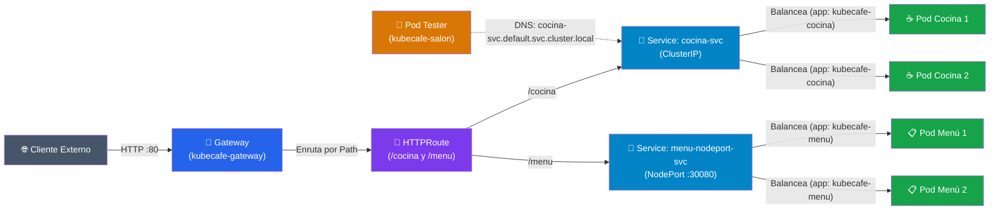

# 🌐 Semana 03: Redes en Kubernetes — Services, CoreDNS y Gateway API

> *"En KubeCafé, los baristas (Pods) rotan de turno y cambian de puesto todo el tiempo. Para que un cliente o la caja no tengan que perseguirlos por todo el local, existen el **Mesero (`Service`)**, la **Puerta Principal (`Gateway`)** y la **Recepcionista (`HTTPRoute`)**."*
>
> 🧪 **Laboratorio Online (sin instalación):** [**Playground del Workshop en iximiuz**](https://labs.iximiuz.com/trainings/fundamentos-de-docker-y-kubernetes-2ae16ea8/)  
> 🇨🇴 **Comunidad Oficial CNCF:** [**Únete a Cloud Native Medellín en CNCF Community Groups**](https://ocgroups.dev/cncf/group/2majk4r)  
> 📚 **Documentación Oficial y Labs:** [**K8s Services**](https://kubernetes.io/es/docs/concepts/services-networking/service/) • [**EndpointSlices**](https://kubernetes.io/docs/concepts/services-networking/endpoint-slices/) • [**DNS para Services y Pods**](https://kubernetes.io/es/docs/concepts/services-networking/dns-pod-service/) • [**CoreDNS**](https://coredns.io/manual/toc/) • [**Kubernetes Gateway API**](https://gateway-api.sigs.k8s.io/) • [**Cilium Gateway API**](https://docs.cilium.io/en/stable/network/servicemesh/gateway-api/gateway-api/) • [**Ejercicios Cilium (Isovalent Labs)**](https://labs.isovalent.com/#/overview) • [**Gateway API Inference Extension**](https://gateway-api-inference-extension.sigs.k8s.io/) • [**Blog K8s Inference Extension**](https://kubernetes.io/blog/2025/06/05/introducing-gateway-api-inference-extension/)

---

## 🎯 Objetivos de Aprendizaje

Al finalizar esta semana serás capaz de:
1. **Entender por qué las IPs de los Pods son efímeras** y cómo un `Service` ofrece una IP virtual estable (`ClusterIP`) y balanceo de carga automático.
2. **Diferenciar los tipos de exposición**:
   - `ClusterIP`: comunicación interna exclusiva dentro del clúster.
   - `NodePort`: exposición externa directa en el rango `30000-32767` de cada nodo.
   - `LoadBalancer` (con **Cilium LB IPAM + L2 Announcements**): asignación de IP externa real (`EXTERNAL-IP`) sin necesidad de abrir un `NodePort` (`allocateLoadBalancerNodePorts: false`).
3. **Usar el DNS interno (`CoreDNS`)** para conectar microservicios por nombre y FQDN (`<service>.<namespace>.svc.cluster.local`).
4. **Inspeccionar `Endpoints` y `EndpointSlices`** (`kubectl get endpoints` / `kubectl get endpointslices`) para diagnosticar si un `Service` está conectado correctamente a sus Pods y entender por qué `EndpointSlices` reemplaza a `Endpoints` en clústeres modernos.
5. **Enrutar tráfico HTTP moderno con Gateway API y AI Gateway** (`Gateway` + `HTTPRoute` + `Canary` por peso + balanceo hacia modelos de IA **Ollama** y `Gateway API Inference Extension` en CPU).
6. **Resolver los 4 retos rotos de la semana** y acumular **+40 XP** en el marcador de la comunidad.

---

## ☕ La Analogía de KubeCafé: Mesero, Puerta y Recepcionista



- **ClusterIP (`cocina-svc`):** El mesero interno que solo atiende pedidos entre las áreas de KubeCafé. Nadie desde la calle puede hablarle directo.
- **NodePort (`menu-nodeport-svc`):** Una ventanilla directa en la fachada del local (puerto `30080`). Útil para pruebas rápidas.
- **CoreDNS:** El directorio telefónico interno; permite llamar a `cocina-svc.default.svc.cluster.local` sin saber en qué mesa (IP) está cada barista.
- **Endpoints vs. EndpointSlices:** La lista real de IPs de los Pods conectados detrás de un `Service`. `Endpoints` guarda todas las IPs en un solo objeto (legado), mientras que **`EndpointSlices`** (el estándar moderno) divide esas IPs en bloques de hasta 100 entradas para escalar mucho mejor en clústeres grandes y soportar dual-stack IPv4/IPv6.
- **Gateway API (`Gateway` + `HTTPRoute`):** La puerta principal elegante del local y la recepcionista que envía `/cocina` a la cocina y `/menu` al menú usando un solo punto de entrada.

---

## 📂 Estructura de la Semana

```text
semana-03-services-gateway/
├── README.md                                        # Esta guía principal
├── 1.ejemplos/                                      # 10 laboratorios guiados + Bonus de redes e IA
│   ├── README.md                                    # Paso a paso interactivo + modo imperativo
│   ├── 01-service-clusterip-interno.yaml            # Deployment + Service ClusterIP
│   ├── 02-service-nodeport-externo.yaml             # Deployment + Service NodePort (:30080)
│   ├── 03-dns-interno-coredns.yaml                  # Namespace kubecafe-salon + Pod curl tester
│   ├── 04-gateway-api-httproute.yaml                # Gateway (Cilium) + HTTPRoute (/cocina y /menu)
│   ├── 04b-httproute-por-dominio.yaml               # HTTPRoute por hostname (cocina.kubecafe.local)
│   ├── 04c-httproute-por-header.yaml                # HTTPRoute por header HTTP (X-Env: beta)
│   ├── 04d-httproute-canary-peso.yaml               # HTTPRoute canary por peso (80% / 20% en /peso)
│   ├── 05-frontend-nodeport-backend-clusterip.yaml  # Integrador Frontend NodePort -> Backend ClusterIP (3 réplicas)
│   ├── 06-canary-solo-service.yaml                  # Canary Deployment con solo Service (75% / 25%)
│   ├── 07-gateway-canary-deployment.yaml            # Canary con Gateway API (80% / 20%) + Monitor /canary-ui
│   ├── 08-gateway-ia-ollama-modelos.yaml            # AI Gateway: Frontend -> 2 modelos Ollama + /ia/auto
│   ├── 09a-crds-inference-extension.yaml            # CRDs: InferencePool e InferenceModel (Gateway API Inference Extension)
│   ├── 09-bonus-gateway-inference-extension.yaml    # Bonus: Gateway API Inference Extension en CPU
│   ├── 09b-frontend-inference-chat.yaml             # Frontend Web (/chat) conectado al Gateway API (/v1/chat/completions)
│   ├── 10a-cilium-ippool-l2.yaml                    # CiliumLoadBalancerIPPool + CiliumL2AnnouncementPolicy
│   └── 10b-service-loadbalancer-app.yaml            # Deployment + Service LoadBalancer (sin NodePort)
└── 2.reto-roto/                                     # 4 Retos con errores de red (+40 XP)
    ├── README.md                                    # Guía de diagnóstico y entrega
    ├── 01-service-selector-roto.yaml                # Error: selector mismatch (Endpoints: <none>)
    ├── 02-service-targetport-incorrecto.yaml        # Error: targetPort equivocado (Connection refused)
    ├── 03-nodeport-fuera-de-rango.yaml              # Error: nodePort fuera de 30000-32767
    └── 04-httproute-parentref-roto.yaml             # Error: parentRefs y backendRefs rotos
```

---

## 🚀 Inicio Rápido

1. **Explora los 10 laboratorios guiados (+ Bonus):**
   Entra a [`1.ejemplos/README.md`](./1.ejemplos/README.md) para desplegar `ClusterIP`, `NodePort`, probar `CoreDNS` (FQDNs), modo imperativo, Frontend ➔ Backend, `Canary`, `Gateway API`, `AI Gateway` y `LoadBalancer` con Cilium L2.
2. **Resuelve los 4 retos rotos (+40 XP):**
   Entra a [`2.reto-roto/README.md`](./2.reto-roto/README.md), reproduce los fallos en tu clúster, repáralos en tu carpeta de `aportes-comunidad/soluciones-retos/<tu-usuario>/semana-03/` y envía tu Pull Request.
3. **Documenta tu bitácora (+10 XP):**
   Usa el [Formulario de Bitácora Semanal](https://github.com/edwinbermudez91/Fundamentos-Kubernetes/issues/new?template=bitacora-semanal.yml) eligiendo `semana-03`.
